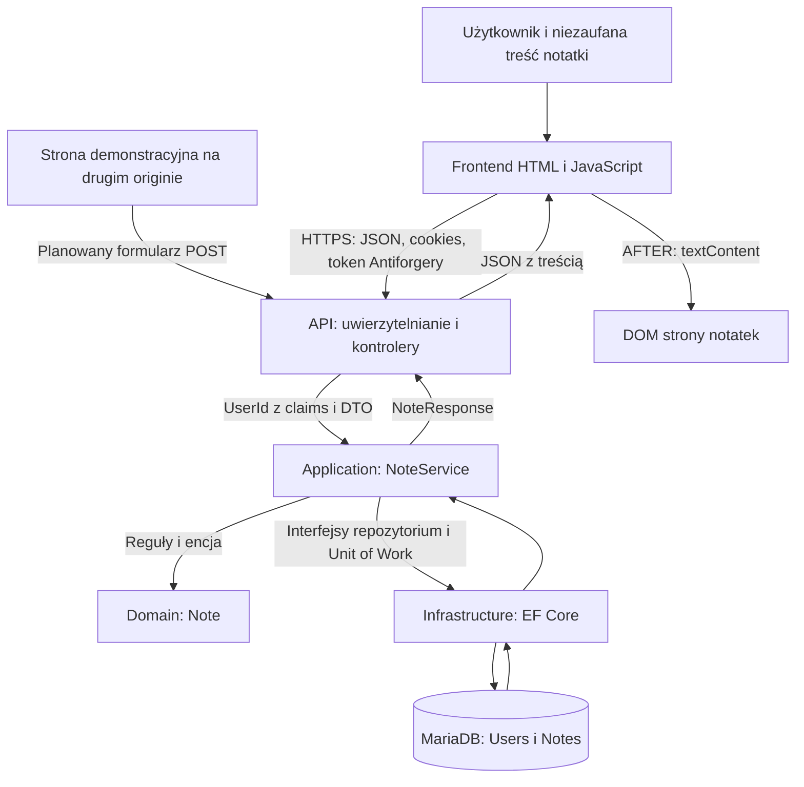

# Architektura i przepływy danych

Stan: `VERIFIED` na podstawie kodu bazowego `21be7bb6aadd69c729250eb5d5248cabb114de04`. Diagram przedstawia strukturę logiczną, nie dowód uruchomienia.

## Warstwy Onion

| Warstwa | Elementy i zależności |
|---|---|
| Domain | `User`, `Note`, `Email`, `IUserRepository`, `INoteRepository`; brak zależności od EF Core i HTTP |
| Application | `RegisterService`, `LoginService`, `NoteService`, DTO i interfejsy bezpieczeństwa oraz Unit of Work; zależy od Domain |
| Infrastructure | `PersistenceContext`, repozytoria, `UnitOfWork`, `PasswordHasher`, `JwtTokenService`; implementuje interfejsy warstw wewnętrznych |
| API | Kontrolery, middleware, konfiguracja DI i JWT; łączy Application i Infrastructure |
| Frontend | Statyczne HTML/CSS oraz moduły `notes.js`, `auth.js`, `home.js`, `api.js`; wywołuje API przez fetch |

Strzałki przedstawiają wywołania i odpowiedzi, nie kierunek zależności projektów. Dodana akcja formularzowa jest tylko planem BEFORE.

## Zapis i odczyt notatki

1. `notes.js.createNote` pobiera tytuł i treść. `api.js.apiRequest` pobiera token z `GET /api/auth/csrf-token`, dodaje `X-CSRF-TOKEN`, serializuje JSON i wysyła cookies tego samego originu.
2. `NotesController` wymaga `[Authorize]`. `Create` w linii 89 ma `[ValidateAntiForgeryToken]`, a dane pochodzą z `[FromBody] CreateNoteRequest`.
3. `GetCurrentUserId` odczytuje `ClaimTypes.NameIdentifier`; użytkownik nie wybiera właściciela w danych żądania.
4. `NoteService.CreateAsync` tworzy encję `Note`, przekazuje ją do repozytorium i wywołuje `SaveChangesAsync`.
5. Domena wymaga niepustego identyfikatora właściciela i tytułu do 150 znaków oraz niepustej referencji treści do 10 000 znaków. Treść nie jest filtrowana jako HTML. Zachowanie tekstu jest poprawne przy bezpiecznym renderowaniu.
6. `GetAllAsync` pobiera wyłącznie notatki właściciela. `NoteResponse` zawiera treść, która wraca jako JSON.
7. `loadNotes` buduje listę. `createNoteElement` przypisuje tytuł do `textContent` w linii 202, a treść do `textContent` w linii 205.

Odczyt, aktualizacja i usunięcie pojedynczej notatki korzystają z `GetByIdAndUserIdAsync`, filtrującego jednocześnie identyfikator notatki i właściciela. Dla niedostępnej notatki kontroler zwraca 404. Ten mechanizm pozostaje poza planowanym osłabieniem.

## Uwierzytelnianie i sesja

`LoginService` sprawdza hasło przez `PasswordHasher<object>`. `JwtTokenService` generuje podpisany HMAC-SHA256 token z `sub`, `jti`, `iat` i terminem ważności. `AuthController.Login` zapisuje go w cookie `SecureNotes.Auth` z HttpOnly, Secure, SameSite=Strict i Path=/.

`JwtAuthenticationExtensions.AddJwtAuthentication` odczytuje cookie, weryfikuje podpis, algorytm, wystawcę, odbiorcę i czas ważności, bez tolerancji czasu (`ClockSkew=0`). To uwierzytelnianie oparte na JWT w cookie; nie znaleziono klasycznej serwerowej sesji ani refresh tokenów w analizowanym przepływie. Wylogowanie usuwa cookies, lecz nie prowadzi do serwerowego unieważnienia wcześniej skopiowanego JWT.

Rejestracja, logowanie, wylogowanie, POST notatki, PUT i DELETE mają walidację Antiforgery. `SecureNotes.Csrf` jest HttpOnly, Secure i SameSite=Strict. Token żądania jest zwracany osobno w JSON i przekazywany przez frontend nagłówkiem.

## Pipeline i granice zaufania

`Program.Main` rejestruje usługi, middleware błędów i nagłówków, migracje w Development, Swagger w Development, HSTS poza Development, przekierowanie HTTPS, pliki statyczne, uwierzytelnianie i autoryzację oraz kontrolery. Nie znaleziono konfiguracji CORS.

Granice zaufania to: dane użytkownika → DOM; przeglądarka → API; cookie → tożsamość po walidacji JWT; DTO → reguły domeny; aplikacja → baza; osobny origin → uwierzytelniona operacja. Dane przechowywane w bazie nadal są niezaufane przy renderowaniu. Samo poprawne uwierzytelnienie żądania nie dowodzi świadomej intencji użytkownika, dlatego potrzebne jest Antiforgery.

Źródła lokalne: `SecureNotes.API/Program.cs`, `Controllers/NotesController.cs`, `Controllers/AuthController.cs`, `Extensions/JwtAuthenticationExtensions.cs`, `wwwroot/js/api.js`, `wwwroot/js/notes.js`, `SecureNotes.Application/Services/NoteService.cs`, `SecureNotes.Domain/Entities/Note.cs`, `SecureNotes.Infrastructure/Persistence/Repositories/NoteRepository.cs`. Numery linii dotyczą bazy i mogą się przesunąć po przyszłych zmianach.
