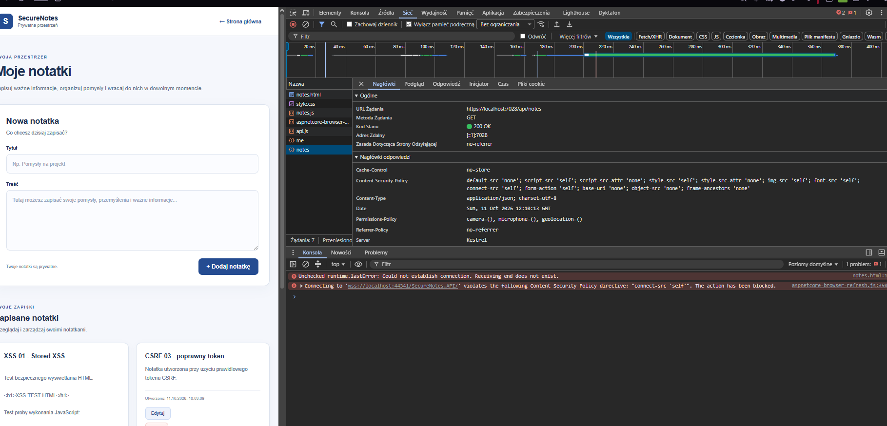
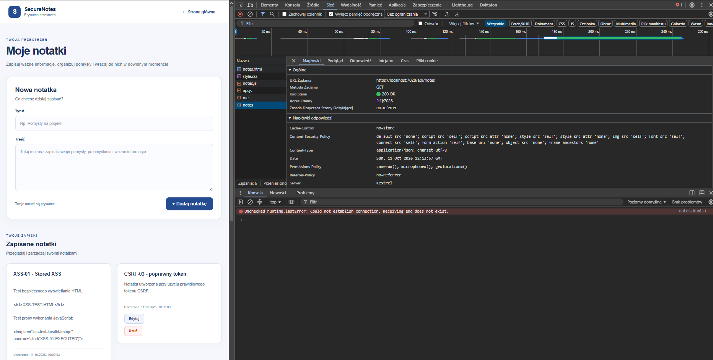
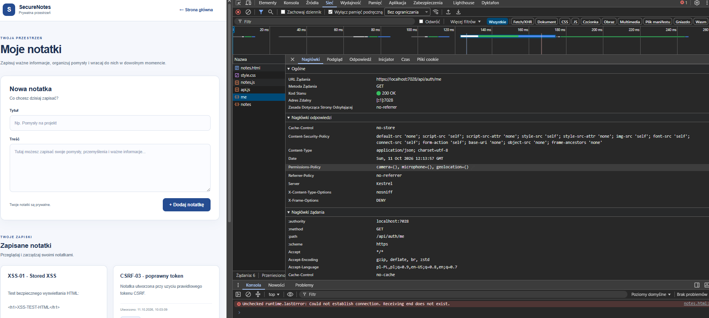
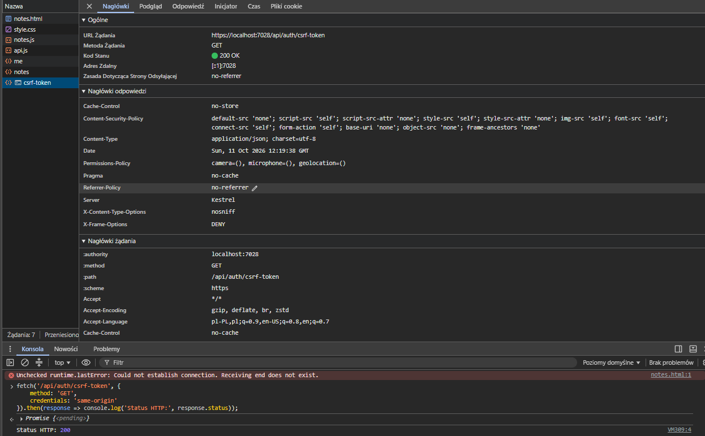
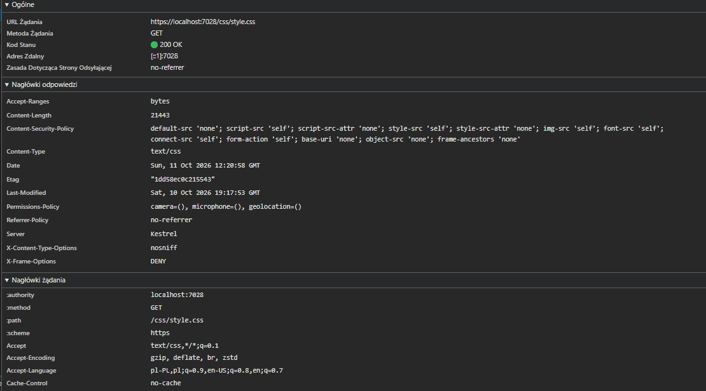

# SecureNotes — Wyniki napraw i retestów bezpieczeñstwa

## 1. Cel dokumentu

Dokument przedstawia dzia³ania naprawcze podjête po zakoñczeniu audytu bezpieczeñstwa SecureNotes oraz wyniki ponownej weryfikacji zabezpieczeñ.

Pierwotne wyniki audytu znajduj¹ siê w `results.md`. Nie s¹ nadpisywane, aby zachowaæ mo¿liwoœæ porównania stanu aplikacji przed napraw¹ i po niej.

**Branch naprawczy:** `fix/security-hardening`

**Data rozpoczêcia retestów:** 11.10.2026

---

## 2. REM-01 — Cache-Control dla odpowiedzi API

### Problem wykryty podczas audytu

W ramach analizy pasywnej OWASP ZAP (ZAP-01) dodatkowo sprawdzono odpowiedŸ `GET /api/notes`.

Serwer zwróci³ HTTP 200 OK z prywatnymi notatkami zalogowanego u¿ytkownika, ale w nag³ówkach odpowiedzi nie stwierdzono obecnoœci `Cache-Control`.

Brak tego nag³ówka nie stanowi³ samodzielnie dowodu wycieku danych, lecz wskazywa³ na potrzebê jawnego okreœlenia zasad przechowywania wra¿liwych odpowiedzi przez pamiêci podrêczne.

### Zastosowana poprawka

Zmodyfikowano:

`SecureNotes.API/Middleware/SecurityHeadersMiddleware.cs`

W istniej¹cym mechanizmie `Response.OnStarting()` dodano warunek:

```csharp
if (context.Request.Path.StartsWithSegments("/api"))
{
    headers["Cache-Control"] = "no-store";
}
```

Poprawka obejmuje odpowiedzi kierowane do œcie¿ek `/api` i ich podœcie¿ek, bez wprowadzania tej samej polityki dla publicznych plików statycznych.

Pozosta³e nag³ówki bezpieczeñstwa, w tym restrykcyjna polityka CSP, zosta³y zachowane.

### Wyniki retestów rêcznych

| ID | Sprawdzony zasób | Wynik oczekiwany | Wynik rzeczywisty | Status |
|---|---|---|---|---|
| CACHE-01 | GET `/api/notes` | HTTP 200, `Cache-Control: no-store` | HTTP 200, `no-store` | PASS |
| CACHE-02 | GET `/api/auth/me` | HTTP 200, `Cache-Control: no-store` | HTTP 200, `no-store` | PASS |
| CACHE-03 | GET `/api/auth/csrf-token` | HTTP 200, `Cache-Control: no-store` | HTTP 200, `no-store` | PASS |
| CACHE-04 | GET `/css/style.css` | HTTP 200, bez nowego `Cache-Control: no-store` | HTTP 200, brak `no-store` | PASS |

### Materia³y dowodowe

**CACHE-01 — prywatne notatki:**



**Dodatkowa kontrola dzia³ania aplikacji po wy³¹czeniu Hot Reload:**



**CACHE-02 — informacje o zalogowanym u¿ytkowniku:**



**CACHE-03 — endpoint tokenu CSRF:**



**CACHE-04 — kontrola pliku statycznego:**



Materia³y dowodowe ograniczono do informacji niezbêdnych do potwierdzenia wyników. Nie publikowano wartoœci JWT, tokenów CSRF ani prywatnej treœci odpowiedzi API.

### Testy regresyjne

Po wprowadzeniu poprawki wykonano:

- Rebuild Solution — zakoñczony sukcesem.
- Test Explorer — 82/82 testy automatyczne zakoñczone sukcesem.
- Rêczn¹ kontrolê dzia³ania strony notatek — aplikacja wyœwietla³a zapisane notatki poprawnie.

### Wynik koñcowy REM-01

**PASS — poprawka potwierdzona dla wszystkich czterech sprawdzonych przypadków.**

Badane odpowiedzi API otrzymuj¹ `Cache-Control: no-store`, natomiast sprawdzony publiczny plik CSS nie zosta³ objêty now¹ polityk¹.

---

## 3. Pozosta³e dzia³ania naprawcze

Do dalszej analizy pozostaj¹:

1. Konfiguracja i weryfikacja HSTS dla œrodowiska produkcyjnego.
2. Ocena zachowania nag³ówków bezpieczeñstwa po wy³¹czeniu pomocniczych mechanizmów Development.
3. Koñcowe testy regresyjne i porównanie wyników z pierwotnym audytem.