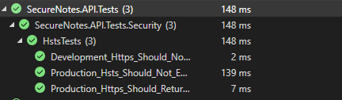

# SecureNotes — Wyniki napraw i retestów bezpieczeñstwa

## 1. Cel dokumentu

Dokument przedstawia dzia³ania naprawcze podjête po zakoñczeniu audytu bezpieczeñstwa SecureNotes oraz wyniki ponownej weryfikacji zabezpieczeñ.

Pierwotne wyniki audytu znajduj¹ siê w `results.md`. Nie s¹ nadpisywane, aby zachowaæ mo¿liwoœæ porównania stanu aplikacji przed napraw¹ i po niej.

**Branch naprawczy:** `fix/security-hardening`

**Data rozpoczêcia retestów:** 11.10.2026

---

## 2. REM-01 — Cache-Control dla odpowiedzi API

### Problem wykryty podczas audytu

W ramach analizy pasywnej OWASP ZAP (ZAP-01) dodatkowo sprawdzono odpowiedŸ `GET /api/notes`.

Serwer zwróci³ HTTP 200 OK z prywatnymi notatkami zalogowanego u¿ytkownika, ale w nag³ówkach odpowiedzi nie stwierdzono obecnoœci `Cache-Control`.

Brak tego nag³ówka nie stanowi³ samodzielnie dowodu wycieku danych, lecz wskazywa³ na potrzebê jawnego okreœlenia zasad przechowywania wra¿liwych odpowiedzi przez pamiêci podrêczne.

### Zastosowana poprawka

Zmodyfikowano:

`SecureNotes.API/Middleware/SecurityHeadersMiddleware.cs`

W istniej¹cym mechanizmie `Response.OnStarting()` dodano warunek:

```csharp
if (context.Request.Path.StartsWithSegments("/api"))
{
    headers["Cache-Control"] = "no-store";
}
```

Poprawka obejmuje odpowiedzi kierowane do œcie¿ek `/api` i ich podœcie¿ek, bez wprowadzania tej samej polityki dla publicznych plików statycznych.

Pozosta³e nag³ówki bezpieczeñstwa, w tym restrykcyjna polityka CSP, zosta³y zachowane.

### Wyniki retestów rêcznych

| ID | Sprawdzony zasób | Wynik oczekiwany | Wynik rzeczywisty | Status |
|---|---|---|---|---|
| CACHE-01 | GET `/api/notes` | HTTP 200, `Cache-Control: no-store` | HTTP 200, `no-store` | PASS |
| CACHE-02 | GET `/api/auth/me` | HTTP 200, `Cache-Control: no-store` | HTTP 200, `no-store` | PASS |
| CACHE-03 | GET `/api/auth/csrf-token` | HTTP 200, `Cache-Control: no-store` | HTTP 200, `no-store` | PASS |
| CACHE-04 | GET `/css/style.css` | HTTP 200, bez nowego `Cache-Control: no-store` | HTTP 200, brak `no-store` | PASS |

### Materia³y dowodowe

**CACHE-01 — prywatne notatki:**


**Dodatkowa kontrola dzia³ania aplikacji po wy³¹czeniu Hot Reload:**


**CACHE-02 — informacje o zalogowanym u¿ytkowniku:**


**CACHE-03 — endpoint tokenu CSRF:**


**CACHE-04 — kontrola pliku statycznego:**


Materia³y dowodowe ograniczono do informacji niezbêdnych do potwierdzenia wyników. Nie publikowano wartoœci JWT, tokenów CSRF ani prywatnej treœci odpowiedzi API.

### Testy regresyjne

Po wprowadzeniu poprawki wykonano:

- Rebuild Solution — zakoñczony sukcesem.
- Test Explorer — 82/82 testy automatyczne zakoñczone sukcesem.
- Rêczn¹ kontrolê dzia³ania strony notatek — aplikacja wyœwietla³a zapisane notatki poprawnie.

### Wynik koñcowy REM-01

**PASS — poprawka potwierdzona dla wszystkich czterech sprawdzonych przypadków.**

Badane odpowiedzi API otrzymuj¹ `Cache-Control: no-store`, natomiast sprawdzony publiczny plik CSS nie zosta³ objêty now¹ polityk¹.

---

## 4. REM-02 — Konfiguracja HSTS

### Problem wykryty podczas audytu

Podczas analizy pasywnej OWASP ZAP (ZAP-01) wykryto brak nag³ówka `Strict-Transport-Security` w odpowiedziach lokalnej aplikacji uruchomionej w œrodowisku Development.

### Zastosowana poprawka

W pliku `SecureNotes.API/Program.cs` zarejestrowano politykê HSTS:

```csharp
builder.Services.AddHsts(options =>
{
    options.MaxAge = TimeSpan.FromDays(30);
    options.IncludeSubDomains = false;
    options.Preload = false;
});
```

Middleware HSTS w³¹czono warunkowo poza œrodowiskiem Development, przed `UseHttpsRedirection()`:

```csharp
if (!app.Environment.IsDevelopment())
{
    app.UseHsts();
}

app.UseHttpsRedirection();
```

Nie zmieniano istniej¹cych profili lokalnego uruchamiania ani polityki CSP.

### Weryfikacja

|   ID    |             Sprawdzany warunek          |          Wynik                            | Status |
|---------|-----------------------------------------|-------------------------------------------|--------|
| HSTS-01 | Izolowany potok Production + HTTPS      | `max-age=2592000`                         | PASS   |
| HSTS-02 | Izolowany potok Development + HTTPS     | Brak nag³ówka HSTS                        | PASS   |
| HSTS-03 | Izolowana polityka Production           | Brak `includeSubDomains` oraz `preload`   | PASS   |

Zweryfikowano równie¿ zawartoœæ rzeczywistego `Program.cs` oraz konfiguracjê `launchSettings.json`.

Testy HSTS wykorzystuj¹ izolowany potok HTTP odtwarzaj¹cy konfiguracjê aplikacji. Nie uruchamiaj¹ rzeczywistego `Program.Main()` ani nie korzystaj¹ z MariaDB.

### Ograniczenia

Nie przeprowadzono testu rzeczywistego wdro¿enia Production.

Przed publikacj¹ aplikacji nale¿y sprawdziæ dzia³anie HSTS na docelowej domenie HTTPS, poprawnoœæ certyfikatu oraz przekierowania HTTP do HTTPS.

Brak HSTS podczas lokalnego uruchomienia w œrodowisku Development jest zgodny z przyjêt¹ konfiguracj¹.

### Testy regresyjne

Po zastosowaniu poprawki wykonano:

-Rebuild Solution — zakoñczony sukcesem.

-Run All Tests — 85/85 testów zakoñczonych sukcesem.

-Nie stwierdzono niepowodzeñ w istniej¹cych testach automatycznych.

**Wynik:** 85/85 PASS.

**Dowód:** `screenshots/retest/hsts-01-automated-tests.png`



### Wynik koñcowy REM-02

PASS — implementacja i izolowane testy konfiguracji HSTS zakoñczone sukcesem.

Weryfikacja rzeczywistego wdro¿enia produkcyjnego pozostaje zadaniem przedwdro¿eniowym.

Data retestu: 11.10.2026.

---


## 3. Pozosta³e dzia³ania naprawcze

---

## 5. Pozosta³e dzia³ania

Po zakoñczeniu REM-01 i REM-02 do dalszej weryfikacji pozostaj¹:

1. Sprawdzenie dzia³ania aplikacji i nag³ówków bezpieczeñstwa bez pomocniczego mechanizmu ASP.NET Core Browser Refresh.
2. Ocena ograniczenia dotycz¹cego Swagger UI przy restrykcyjnej polityce CSP.
3. Koñcowe testy regresyjne po wszystkich zmianach.
4. Weryfikacja konfiguracji rzeczywistego œrodowiska Production przed wdro¿eniem, w tym HTTPS i HSTS.

Pierwotne wyniki audytu pozostaj¹ dostêpne w `results.md` i nie zosta³y nadpisane.