# SecureNotes — wyniki końcowych testów bezpieczeństwa

## Informacje o audycie

- Projekt: SecureNotes
- Branch: `test/security-audit`
- Adres aplikacji: `https://localhost:7028/`
- Środowisko: lokalne, ASP.NET Core .NET 8, MariaDB
- Ostatni potwierdzony wynik testów automatycznych przed audytem: 82/82
- Status audytu: w trakcie realizacji

Dokument zawiera wyniki rzeczywiście wykonanych testów. Scenariusze oczekujące na wykonanie mają status NOT RUN.

---

## 1. Podsumowanie wyników

|	 ID		|               Obszar						|         Oczekiwany wynik				|                 Rzeczywisty wynik							|			Ocena		|
|-----------|-------------------------------------------|---------------------------------------|-----------------------------------------------------------|-----------------------|
| AUTH-01	| Dostęp do notatek bez sesji				| HTTP 401								| HTTP 401 Unauthorized										| PASS					|
| AUTH-02	| Dostęp do /api/auth/me bez sesji			| HTTP 401								| HTTP 401 Unauthorized										| PASS					|
| AUTH-03	| Dostęp do notatek po logowaniu			| HTTP 200								| HTTP 200 OK												| PASS					|
| AUTH-04	| Dostęp do notatek po wylogowaniu			| HTTP 401								| HTTP 401 Unauthorized										| PASS					|
| IDOR-01	| Odczyt cudzej notatki						| HTTP 404								| HTTP 404 Not Found										| PASS					|
| IDOR-02	| Edycja cudzej notatki						| HTTP 404, brak zmiany danych			| HTTP 404, notatka niezmieniona							| PASS					|
| IDOR-03	| Usunięcie cudzej notatki					| HTTP 404, notatka nadal istnieje		| HTTP 404, notatka zachowana								| PASS					|
| CSRF-01	| Brak tokenu CSRF							| HTTP 400								| HTTP 400, notatka nieutworzona							| PASS					|
| CSRF-02	| Nieprawidłowy token CSRF					| HTTP 400								| HTTP 400, notatka nieutworzona							| PASS					|
| CSRF-03	| Prawidłowy token CSRF						| HTTP 201								| HTTP 201, notatka utworzona								| PASS					|
| XSS-01	| Stored XSS w treści notatki				| Brak wykonania JS, HTML jako tekst	| Payload wyświetlony jako tekst, brak wykonania JS			| PASS					|
| HEAD-01	| Nagłówek Content-Security-Policy			| CSP obecny i zgodny z konfiguracją	| CSP obecny, dyrektywy zgodne								| PASS					|
| HEAD-02	| Nagłówek X-Content-Type-Options			| nosniff								| nosniff													| PASS					|
| HEAD-03	| Nagłówek X-Frame-Options					| DENY									| DENY														| PASS					|
| COOKIE-01 | Atrybuty ciasteczka uwierzytelniającego	| HttpOnly, Secure, SameSite=Strict		| Wszystkie trzy atrybuty potwierdzone						| PASS					|
| ZAP-01	| OWASP ZAP									| Analiza i udokumentowanie ustaleń		| Analiza zakończona; 7 kategorii alertów sklasyfikowanych	| PASS (z ustaleniami)	|

---

### Podsumowanie dotychczas wykonanych testów

Dotychczas wykonano piętnaście scenariuszy końcowego audytu bezpieczeństwa SecureNotes.

|		Grupa			|			Wynik			|
|-----------------------|---------------------------|
| AUTH-01–AUTH-04		| 4/4 PASS					|
| IDOR-01–IDOR-03		| 3/3 PASS					|
| CSRF-01–CSRF-03		| 3/3 PASS					|
| XSS-01				| 1/1 PASS					|
| HEAD-01–HEAD-03		| 3/3 PASS					|
| COOKIE-01				| 1/1 PASS					|
| ZAP-01				| 1/1 PASS (z ustaleniami)	|
| **Łącznie wykonane**	| **16/16 PASS**			|

Wykonano wszystkie 16 zaplanowanych scenariuszy końcowego audytu bezpieczeństwa SecureNotes.

Wyniki testów funkcjonalnych zabezpieczeń były zgodne z oczekiwaniami. Analiza pasywna OWASP ZAP została zakończona i ujawniła dodatkowe ustalenia konfiguracyjne, 
w szczególności brak HSTS w lokalnym środowisku Development oraz brak jawnej polityki Cache-Control w badanej odpowiedzi zawierającej prywatne notatki.

Zalecenia te zostały udokumentowane i powinny zostać rozpatrzone przed wdrożeniem aplikacji do środowiska produkcyjnego.

Zakończenie zaplanowanych testów nie jest równoznaczne z potwierdzeniem całkowitej odporności aplikacji na wszystkie zagrożenia bezpieczeństwa.

Testy potwierdziły poprawne działanie badanych mechanizmów uwierzytelniania, kontroli dostępu do notatek, ochrony CSRF, 
	bezpiecznego wyświetlania testowej treści HTML/JavaScript oraz wybranych nagłówków bezpieczeństwa.

Potwierdzono również, że ciasteczko uwierzytelniające `SecureNotes.Auth` posiada atrybuty `HttpOnly`, `Secure` i `SameSite=Strict`.

Wszystkie dotychczas wykonane scenariusze zostały udokumentowane zrzutami ekranu i otrzymały ocenę PASS.

Do zakończenia audytu pozostaje test ZAP-01. Wynik 15/15 odnosi się wyłącznie do już wykonanych scenariuszy.

---

## 2. Szczegółowe wyniki

### AUTH-01 — Dostęp do notatek bez uwierzytelnienia

**Cel:** sprawdzenie, czy użytkownik bez aktywnej sesji może pobrać prywatne notatki przez API.

**Warunki początkowe:** prywatne okno Opera GX, brak aktywnej sesji użytkownika.

**Przebieg:**
1. Uruchomiono aplikację SecureNotes.
2. Otworzono prywatne okno przeglądarki.
3. Wykonano żądanie GET `/api/notes`.
4. Sprawdzono odpowiedź w Opera GX DevTools, w zakładce Network → Headers.

**Oczekiwany wynik:** HTTP 401 Unauthorized. Brak dostępu do prywatnych notatek.

**Wynik rzeczywisty:** Serwer zwrócił HTTP 401 Unauthorized. Odpowiedź miała `Content-Length: 0`, a prywatne notatki nie zostały udostępnione.

**Ocena:** PASS.

**Dowód:** `screenshots/auth/auth-01-unauthorized-notes.png`


**Data wykonania:** 11.10.2026.

**Uwagi:** Dodatkowo zaobserwowano obecność nagłówków bezpieczeństwa, w tym Content-Security-Policy, X-Content-Type-Options oraz X-Frame-Options. 
			Ich szczegółowa weryfikacja zostanie przeprowadzona w osobnej grupie testów HEAD.


---

### AUTH-02 — Weryfikacja sesji bez uwierzytelnienia

**Cel:** sprawdzenie, czy endpoint `/api/auth/me` odmawia udostępnienia informacji o aktualnym użytkowniku w przypadku braku aktywnej sesji.

**Warunki początkowe:** prywatne okno Opera GX, użytkownik niezalogowany.

**Przebieg:**
1. Uruchomiono aplikację SecureNotes.
2. W prywatnym oknie przeglądarki wykonano żądanie GET `/api/auth/me`.
3. W narzędziach deweloperskich, w zakładce Network → Headers, sprawdzono status odpowiedzi HTTP.

**Oczekiwany wynik:** HTTP 401 Unauthorized.

**Wynik rzeczywisty:** Serwer zwrócił HTTP 401 Unauthorized i odmówił dostępu do informacji o aktualnym użytkowniku.

**Ocena:** PASS.

**Dowód:** `screenshots/auth/auth-02-unauthorized-me.png`


**Data wykonania:** 11.10.2026.

**Uwagi:** Test przeprowadzono bez aktywnej sesji, w prywatnym oknie przeglądarki. Endpoint poprawnie wymaga uwierzytelnienia.

---

### AUTH-03 — Dostęp do notatek po zalogowaniu

**Cel:** sprawdzenie, czy poprawnie uwierzytelniony użytkownik może pobrać listę swoich prywatnych notatek.

**Warunki początkowe:** aktywna sesja testowego użytkownika w prywatnym oknie Opera GX.

**Przebieg:**
1. Uruchomiono lokalną aplikację SecureNotes.
2. Zalogowano się przez formularz logowania na konto testowe.
3. W tym samym oknie przeglądarki wykonano żądanie GET `/api/notes`.
4. Sprawdzono odpowiedź w Opera GX DevTools, w zakładce Network → Headers.

**Oczekiwany wynik:** HTTP 200 OK oraz odpowiedź zawierająca listę notatek użytkownika lub pustą tablicę JSON.

**Wynik rzeczywisty:** Serwer zwrócił HTTP 200 OK. Uwierzytelniony użytkownik uzyskał dostęp do endpointu swoich notatek.

**Ocena:** PASS.

**Dowód:** `screenshots/auth/auth-03-authorized-notes.png`


**Data wykonania:** 11.10.2026.

**Uwagi:** Test potwierdza dostęp do chronionego endpointu z aktywną sesją JWT. Kontrola dostępu do notatek innych użytkowników będzie przedmiotem osobnych testów IDOR.

---

### AUTH-04 — Dostęp do notatek po wylogowaniu

**Cel:** sprawdzenie, czy użytkownik po wylogowaniu przez interfejs SecureNotes traci dostęp do chronionego endpointu notatek.

**Warunki początkowe:** użytkownik wcześniej poprawnie zalogowany; test AUTH-03 potwierdził dostęp do GET `/api/notes` (HTTP 200).

**Przebieg:**
1. Pozostawiono aktywne prywatne okno przeglądarki po wykonaniu AUTH-03.
2. Wykonano wylogowanie za pomocą interfejsu SecureNotes.
3. Bez zamykania okna i bez ręcznego usuwania ciasteczek ponownie wykonano GET `/api/notes`.
4. Sprawdzono odpowiedź w Opera GX DevTools, w zakładce Network → Headers.

**Oczekiwany wynik:** HTTP 401 Unauthorized. Po wylogowaniu przeglądarka nie powinna mieć dostępu do prywatnych notatek.

**Wynik rzeczywisty:** Serwer zwrócił HTTP 401 Unauthorized. Po wylogowaniu dostęp do chronionego endpointu został zablokowany w badanej sesji przeglądarki.

**Ocena:** PASS.

**Dowód:** `screenshots/auth/auth-04-after-logout.png`


**Data wykonania:** 11.10.2026.

**Uwagi:** Test wykonano w tym samym oknie przeglądarki co AUTH-03. Nie usuwano ręcznie ciasteczek i nie zamykano sesji przeglądarki. 
			Test potwierdza skuteczność wylogowania w standardowym przepływie aplikacji; nie stanowi osobnego testu unieważniania skopiowanego wcześniej tokenu JWT.

---

## 3. Szczegółowe wyniki pozostałych grup testów


### IDOR-01 — Próba odczytu notatki innego użytkownika

**Cel:** sprawdzenie, czy zalogowany użytkownik może uzyskać dostęp do notatki należącej do innego konta poprzez bezpośrednie podanie jej identyfikatora.

**Warunki początkowe:** dwa aktywne, odrębne konta testowe. Użytkownik A posiada notatkę testową. Użytkownik B jest zalogowany w osobnym, prywatnym oknie przeglądarki.

**Przebieg:**
1. Zalogowano się na konto użytkownika A.
2. Utworzono notatkę testową i pobrano jej identyfikator z odpowiedzi GET `/api/notes`.
3. W osobnym oknie zalogowano się na konto użytkownika B.
4. Wykonano żądanie GET `/api/notes/{id}`, wykorzystując identyfikator notatki użytkownika A.
5. Sprawdzono status odpowiedzi w Opera GX DevTools.
6. Ponownie sprawdzono dostępność oryginalnej notatki na koncie A.

**Oczekiwany wynik:** HTTP 404 Not Found. Brak możliwości odczytu cudzej notatki. Oryginalna notatka pozostaje dostępna dla właściciela.

**Wynik rzeczywisty:** Użytkownik B otrzymał HTTP 404 Not Found. Treść cudzej notatki nie została udostępniona. Użytkownik A nadal miał dostęp do swojej notatki.

**Ocena:** PASS.

**Dowód:** `screenshots/idor/idor-01-foreign-note-404.png`

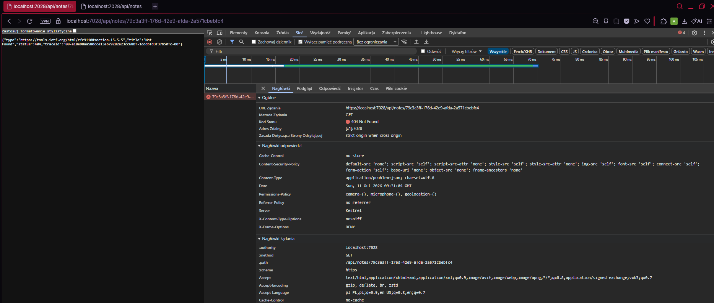

**Data wykonania:** 11.10.2026.	

**Uwagi:** Test potwierdza kontrolę właściciela zasobu w operacji odczytu pojedynczej notatki. Zastosowanie odpowiedzi 404 nie ujawnia użytkownikowi B, czy wskazana notatka istnieje.

---

### IDOR-02 — Próba nieuprawnionej edycji cudzej notatki

**Cel:** sprawdzenie, czy zalogowany użytkownik może zmodyfikować notatkę należącą do innego użytkownika poprzez bezpośrednie wskazanie jej identyfikatora.

**Warunki początkowe:** dwa odrębne konta testowe. Użytkownik A jest właścicielem notatki utworzonej podczas IDOR-01. Użytkownik B jest zalogowany w osobnym, prywatnym oknie przeglądarki.

**Przebieg:**
1. Sprawdzono pierwotny tytuł i treść notatki użytkownika A.
2. W sesji użytkownika B wykonano żądanie PUT `/api/notes/{id}`, podając identyfikator notatki użytkownika A.
3. Do żądania dołączono prawidłowy token CSRF za pośrednictwem istniejącej funkcji `apiRequest()`.
4. Sprawdzono kod odpowiedzi HTTP w Opera GX DevTools.
5. Ponownie odczytano oryginalną notatkę na koncie użytkownika A i porównano jej tytuł oraz treść ze stanem sprzed testu.

**Oczekiwany wynik:** HTTP 404 Not Found. Próba nieuprawnionej aktualizacji zostaje odrzucona, a oryginalna notatka pozostaje niezmieniona.

**Wynik rzeczywisty:** Serwer zwrócił HTTP 404 Not Found. Po odświeżeniu panelu użytkownika A potwierdzono, że tytuł i treść notatki nie zostały zmodyfikowane.

**Ocena:** PASS.

**Dowody:**

- `screenshots/idor/idor-02-foreign-note-update-404.png`
- `screenshots/idor/idor-02-original-note-unchanged.png`

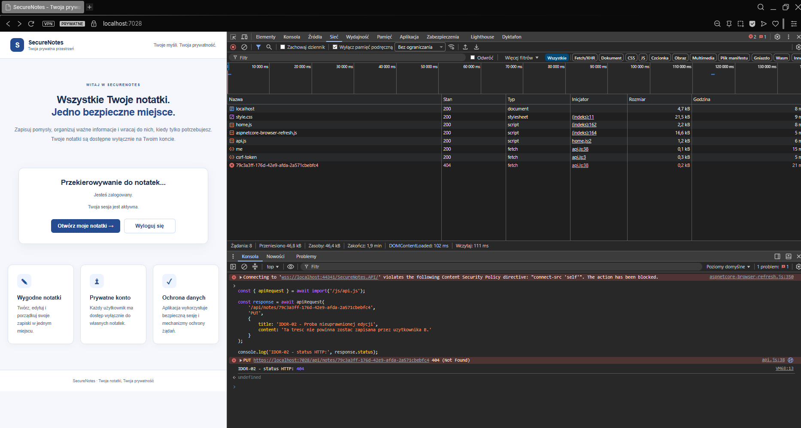

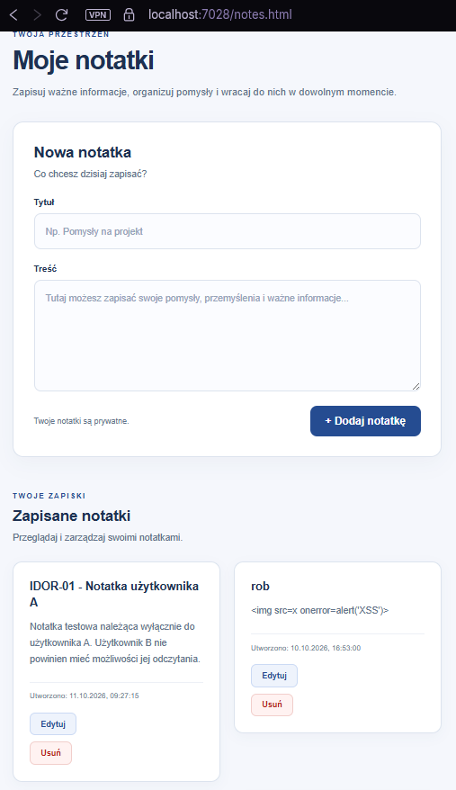

**Data wykonania:** 11.10.2026.	

**Uwagi:** Prawidłowy token CSRF umożliwił sprawdzenie właściwego mechanizmu autoryzacji. Test potwierdza, że sam identyfikator notatki nie daje uprawnień do jej aktualizacji.

---

### IDOR-03 — Próba nieuprawnionego usunięcia cudzej notatki

**Cel:** sprawdzenie, czy zalogowany użytkownik może usunąć notatkę należącą do innego użytkownika poprzez bezpośrednie wskazanie jej identyfikatora.

**Warunki początkowe:** dwa odrębne konta testowe. Użytkownik A posiada notatkę utworzoną podczas IDOR-01. Użytkownik B jest zalogowany w osobnym, prywatnym oknie przeglądarki.

**Przebieg:**
1. Potwierdzono istnienie notatki użytkownika A.
2. W sesji użytkownika B wykonano żądanie DELETE `/api/notes/{id}`, podając identyfikator notatki użytkownika A.
3. Do żądania dołączono prawidłowy token CSRF za pośrednictwem istniejącej funkcji `apiRequest()`.
4. Sprawdzono kod odpowiedzi HTTP w Opera GX DevTools.
5. Ponownie otwarto panel użytkownika A i sprawdzono, czy oryginalna notatka nadal istnieje.

**Oczekiwany wynik:** HTTP 404 Not Found. Nieuprawniona operacja usunięcia zostaje odrzucona, a notatka pozostaje dostępna dla właściciela.

**Wynik rzeczywisty:** Serwer zwrócił HTTP 404 Not Found. Po ponownym otwarciu panelu użytkownika A potwierdzono, że notatka nadal istnieje i nie została usunięta.

**Ocena:** PASS.

**Dowody:**

- `screenshots/idor/idor-03-foreign-note-delete-404.png`
- `screenshots/idor/idor-03-original-note-exists.png`

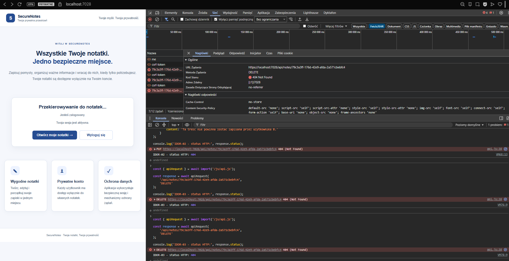

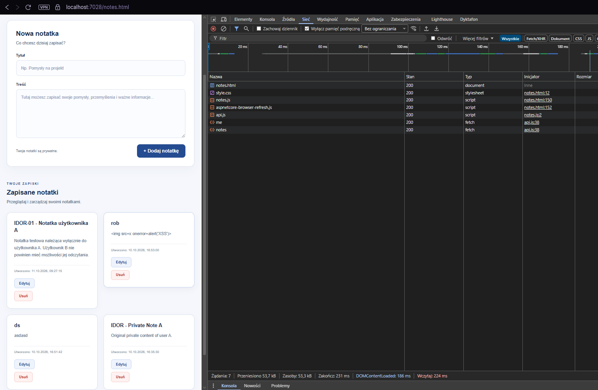

**Data wykonania:** 11.10.2026.

**Uwagi:** Prawidłowy token CSRF umożliwił weryfikację mechanizmu autoryzacji. Test sprawdza, czy znajomość identyfikatora zasobu nie pozwala innemu zalogowanemu użytkownikowi na jego usunięcie.

---

### CSRF-01 — Próba utworzenia notatki bez tokenu CSRF

**Cel:** sprawdzenie, czy aplikacja odrzuca żądanie modyfikujące dane w przypadku braku wymaganego tokenu anty-CSRF.

**Warunki początkowe:** użytkownik A jest poprawnie zalogowany i posiada aktywną sesję. Mechanizm Antiforgery oraz SecurityHeadersMiddleware pozostają włączone.

**Przebieg:**
1. Zalogowano się na konto testowe A.
2. W konsoli przeglądarki wykonano żądanie POST `/api/notes`, korzystając z funkcji `fetch()`.
3. Do żądania dołączono poprawne dane JSON, ale celowo pominięto nagłówek `X-CSRF-TOKEN`.
4. Sprawdzono status odpowiedzi w Opera GX DevTools.
5. Odświeżono listę notatek, aby zweryfikować, czy żądanie nie spowodowało utworzenia nowego obiektu.

**Oczekiwany wynik:** HTTP 400 Bad Request. Nowa notatka nie zostaje utworzona.

**Wynik rzeczywisty:** Serwer zwrócił HTTP 400 Bad Request. Żądanie bez tokenu CSRF zostało odrzucone, a testowa notatka nie pojawiła się na liście użytkownika.

**Ocena:** PASS.

**Dowody:**

- `screenshots/csrf/csrf-01-missing-token-400.png`
- `screenshots/csrf/csrf-01-note-not-created.png`

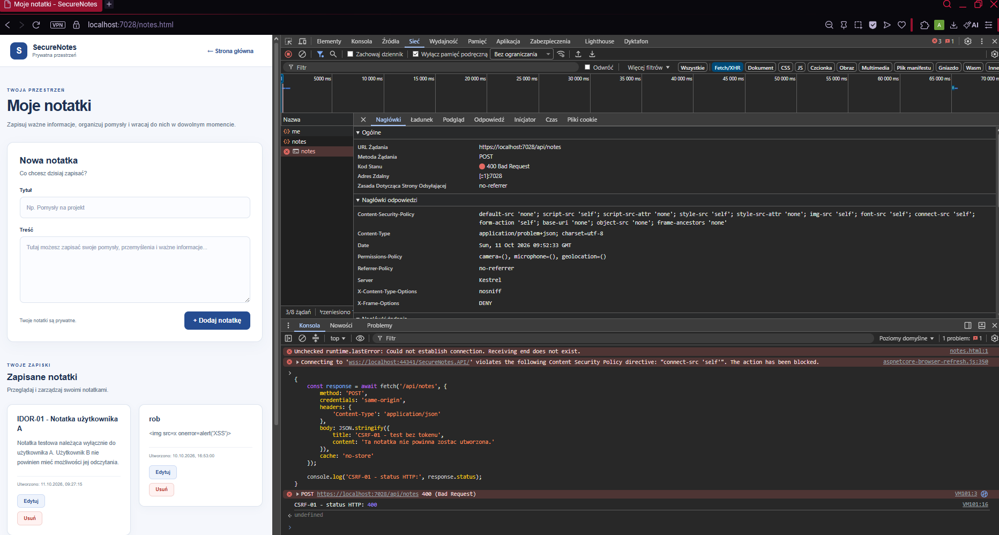

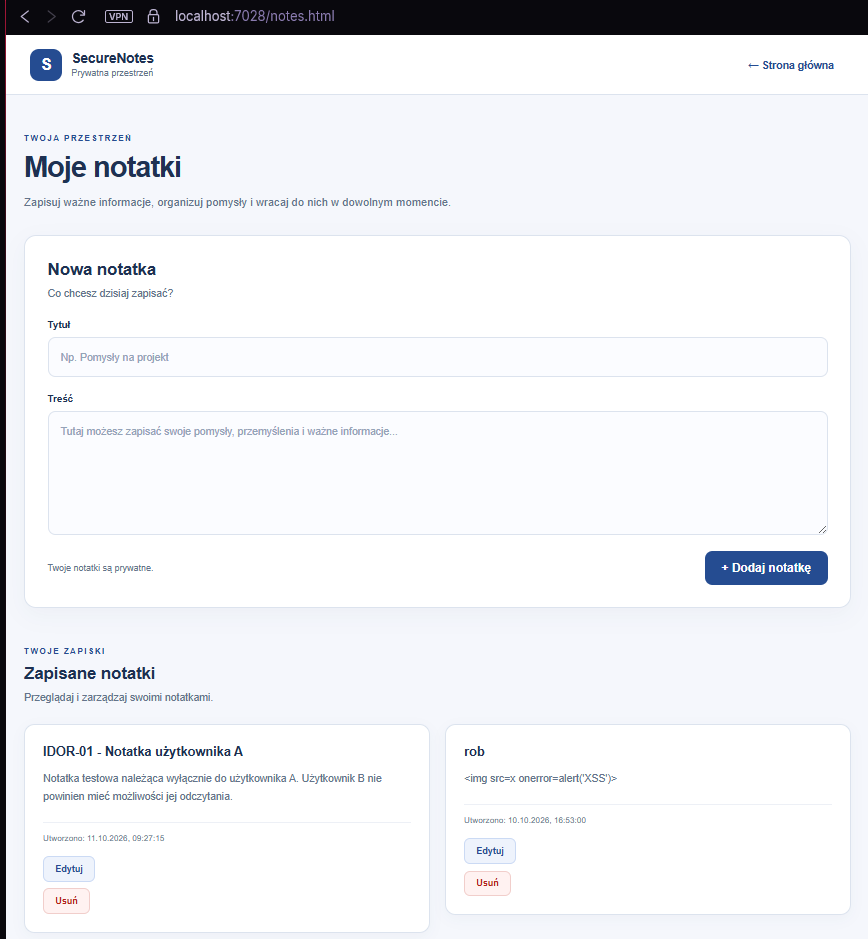

**Data wykonania:** 11.10.2026.

**Uwagi:** Użytkownik posiadał aktywną sesję uwierzytelnioną. Test weryfikował wyłącznie brak tokenu CSRF, bez wyłączania mechanizmu Antiforgery ani innych zabezpieczeń aplikacji.

---

### CSRF-02 — Próba utworzenia notatki z nieprawidłowym tokenem CSRF

**Cel:** sprawdzenie, czy aplikacja weryfikuje poprawność tokenu anty-CSRF i odrzuca żądanie zawierające nieprawidłową wartość nagłówka `X-CSRF-TOKEN`.

**Warunki początkowe:** użytkownik A jest poprawnie zalogowany i posiada aktywną sesję. Mechanizmy Antiforgery oraz SecurityHeadersMiddleware pozostają aktywne.

**Przebieg:**
1. Zalogowano się na konto testowe A.
2. W konsoli Opera GX wykonano żądanie POST `/api/notes` przy użyciu funkcji `fetch()`.
3. Wysłano prawidłowe dane JSON oraz nagłówek `X-CSRF-TOKEN` o celowo nieprawidłowej wartości.
4. Sprawdzono odpowiedź HTTP w zakładce Network → Headers.
5. Odświeżono listę notatek, aby zweryfikować, czy nie doszło do utworzenia nowego obiektu.

**Oczekiwany wynik:** HTTP 400 Bad Request. Testowa notatka nie zostaje utworzona.

**Wynik rzeczywisty:** Serwer zwrócił HTTP 400 Bad Request. Nieprawidłowy token CSRF został odrzucony, a testowa notatka nie została utworzona.

**Ocena:** PASS.

**Dowody:**
- `screenshots/csrf/csrf-02-invalid-token-400.png`
- `screenshots/csrf/csrf-02-note-not-created.png`

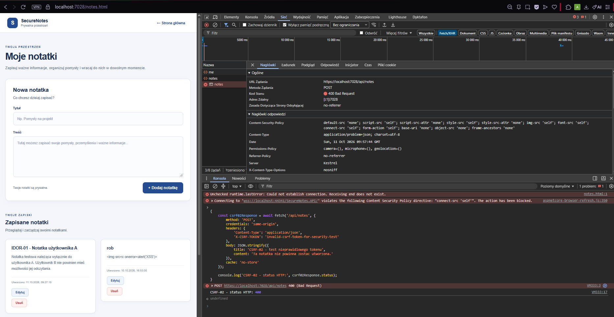

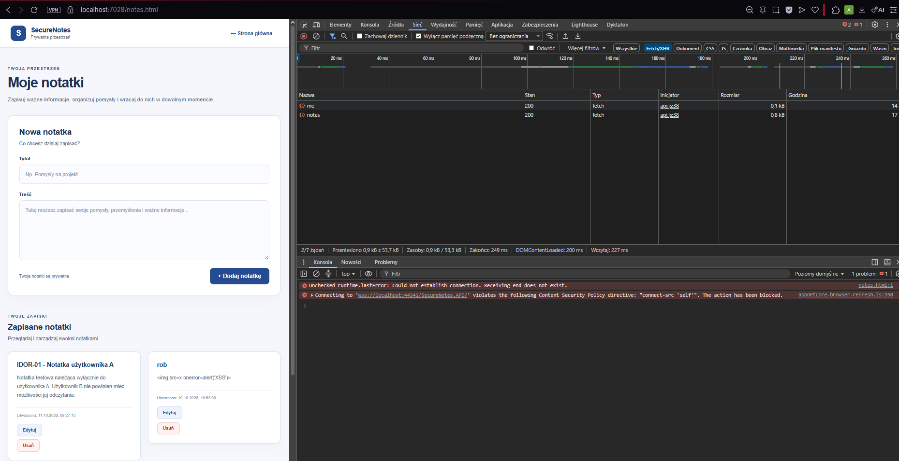

**Data wykonania:** 11.10.2026.

**Uwagi:** W przeciwieństwie do CSRF-01 nagłówek `X-CSRF-TOKEN` był obecny, lecz zawierał nieprawidłową wartość. 
			Test pozwolił sprawdzić walidację tokenu, a nie tylko kontrolę jego obecności.

---

### CSRF-03 — Utworzenie notatki z prawidłowym tokenem CSRF

**Cel:** sprawdzenie, czy aplikacja akceptuje poprawne żądanie modyfikujące dane, zawierające ważny token anty-CSRF.

**Warunki początkowe:** użytkownik A jest poprawnie zalogowany i posiada aktywną sesję. Mechanizmy Antiforgery oraz SecurityHeadersMiddleware pozostają włączone.

**Przebieg:**
1. Zalogowano się na konto testowe A.
2. Wykorzystano istniejącą funkcję `apiRequest()` z modułu `/js/api.js`.
3. Funkcja pobrała token za pomocą endpointu GET `/api/auth/csrf-token`.
4. Wykonano żądanie POST `/api/notes` z poprawnymi danymi JSON i prawidłowym tokenem CSRF.
5. Sprawdzono odpowiedź HTTP w Opera GX DevTools.
6. Odświeżono panel notatek i zweryfikowano obecność nowo utworzonej notatki.

**Oczekiwany wynik:** HTTP 201 Created. Nowa notatka zostaje zapisana i jest dostępna na koncie użytkownika A.

**Wynik rzeczywisty:** Serwer zwrócił HTTP 201 Created. Po odświeżeniu panelu potwierdzono obecność notatki „CSRF-03 - poprawny token”.

**Ocena:** PASS.

**Dowody:**

- `screenshots/csrf/csrf-03-valid-token-201.png`
- `screenshots/csrf/csrf-03-note-created.png`

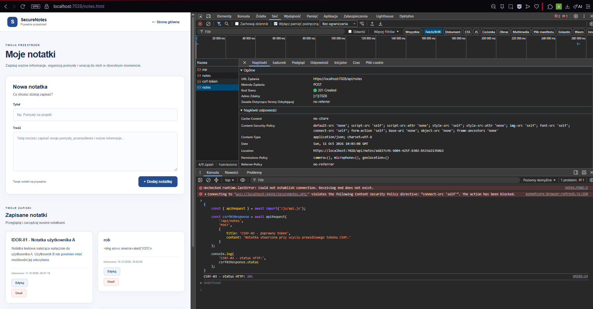

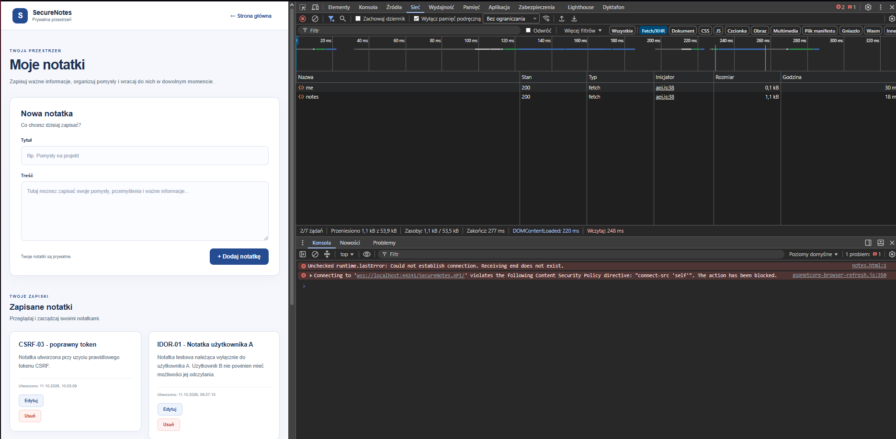

**Data wykonania:** 11.10.2026.

**Uwagi:** Wynik uzupełnia testy CSRF-01 i CSRF-02. Potwierdza, że aplikacja odrzuca żądania bez poprawnego tokenu CSRF, 
			ale pozwala wykonywać operacje z prawidłowym tokenem i aktywną sesją.

---

### XSS-01 — Próba Stored XSS w treści notatki

**Cel:** sprawdzenie, czy aplikacja bezpiecznie wyświetla zapisane przez użytkownika fragmenty HTML i JavaScript, bez interpretowania ich jako aktywny kod przeglądarki.

**Warunki początkowe:** uruchomiona aplikacja SecureNotes, aktywna sesja użytkownika testowego A oraz włączony mechanizm Content Security Policy (CSP).

**Dane testowe:**

```text
<h1>XSS-TEST-HTML</h1>


```

**Przebieg:**
1. Zalogowano się na konto testowe A.
2. Utworzono notatkę `XSS-01 - Stored XSS`, zawierającą kontrolowany fragment HTML oraz próbę wykonania JavaScript.
3. Zapisano notatkę za pomocą interfejsu SecureNotes.
4. Odświeżono stronę, aby ponownie pobrać notatkę z API i wyświetlić zapisane dane.
5. Sprawdzono, czy znaczniki HTML są widoczne dosłownie jako tekst.
6. Zweryfikowano brak wykonania JavaScript oraz strukturę DOM notatki w Opera GX DevTools.

**Oczekiwany wynik:** testowy fragment HTML jest wyświetlany jako zwykły tekst, nie tworzy dodatkowych elementów DOM i nie prowadzi do wykonania JavaScript.

**Wynik rzeczywisty:** Po zapisaniu i ponownym wyświetleniu notatki znaczniki HTML pozostały widoczne jako zwykły tekst. Nie pojawiło się okno `XSS-01-EXECUTED`. 
							Kontrola DOM nie wykazała utworzenia dodatkowych elementów HTML wewnątrz treści notatki.

**Ocena:** PASS.

**Dowody:**

- `screenshots/xss/xss-01-test-note-created.png`
- `screenshots/xss/xss-01-payload-rendered-as-text.png`
- `screenshots/xss/xss-01-dom-verification.png`

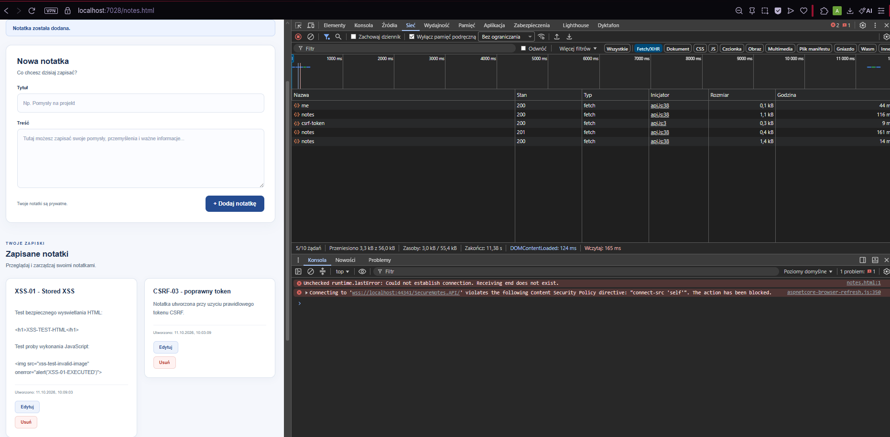

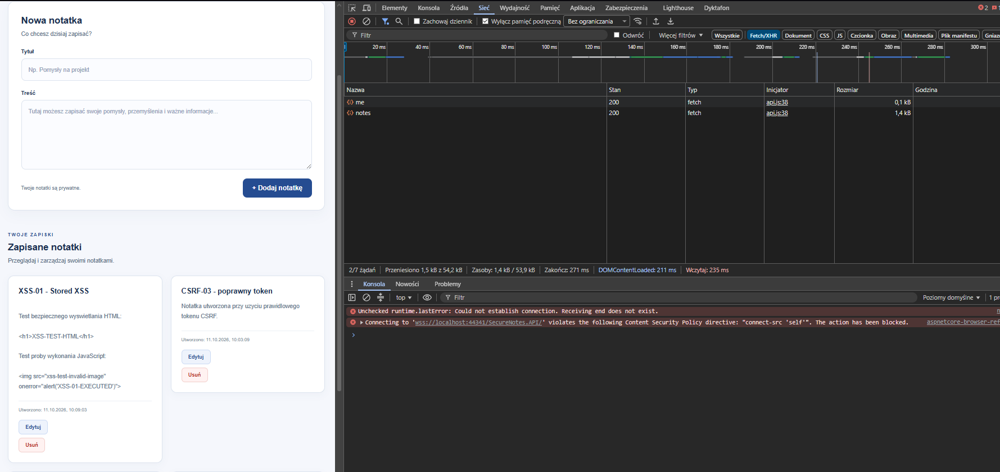

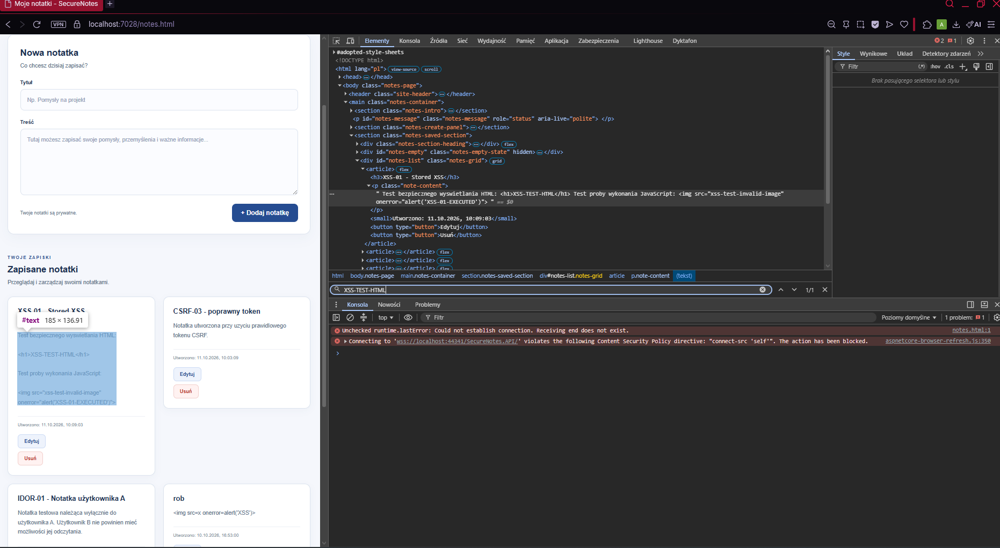

**Data wykonania:** 11.10.2026.

**Uwagi:** Test dotyczył scenariusza Stored XSS w treści notatki. Brak wykonania JavaScript oceniono łącznie z kontrolą struktury DOM, 
			aby odróżnić bezpieczne wyświetlanie tekstu od samego blokowania skryptów przez CSP. Nie wyłączano żadnych zabezpieczeń aplikacji.

---

### HEAD-01 — Weryfikacja nagłówka Content-Security-Policy

**Cel:** sprawdzenie, czy SecureNotes wysyła aktywny nagłówek Content-Security-Policy (CSP), 
			ograniczający źródła zasobów i możliwości wykonywania potencjalnie niebezpiecznego kodu w przeglądarce.

**Warunki początkowe:** uruchomiona aplikacja SecureNotes, włączony SecurityHeadersMiddleware oraz otwarta przeglądarka Opera GX.

**Przebieg:**
1. Otworzono stronę `https://localhost:7028/notes.html`.
2. Uruchomiono Opera GX DevTools i przełączono się do zakładki Network.
3. Odświeżono stronę i wybrano żądanie dokumentu `GET /notes.html`.
4. Sprawdzono kod odpowiedzi HTTP oraz sekcję Response Headers.
5. Zweryfikowano obecność aktywnego nagłówka `Content-Security-Policy` i porównano jego dyrektywy z konfiguracją SecureNotes.

**Oczekiwany wynik:** odpowiedź HTTP 200 OK oraz obecność restrykcyjnego nagłówka CSP, 
						zawierającego między innymi `default-src 'none'`, `script-src 'self'`, `script-src-attr 'none'`, `object-src 'none'` i `frame-ancestors 'none'`.

**Wynik rzeczywisty:** Serwer zwrócił HTTP 200 OK. W nagłówkach odpowiedzi znajdował się aktywny `Content-Security-Policy`, którego dyrektywy były zgodne z konfiguracją aplikacji.

**Ocena:** PASS.

**Dowód:** `screenshots/headers/head-01-content-security-policy.png`

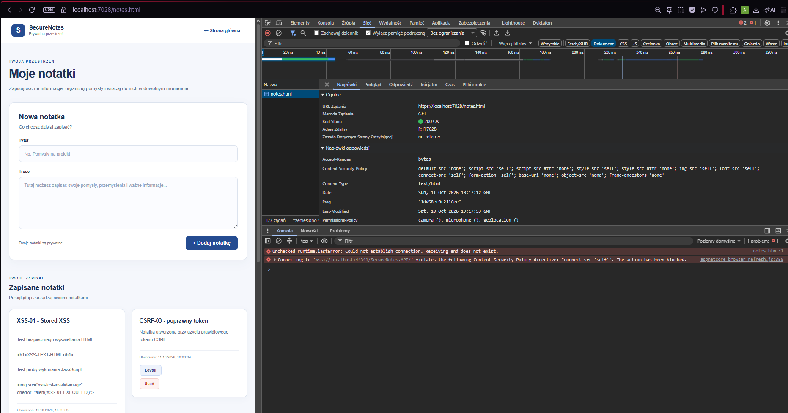

**Data wykonania:** 11.10.2026.

**Uwagi:** Test przeprowadzono bez wyłączania SecurityHeadersMiddleware. Zweryfikowano nagłówek Content-Security-Policy, 
			a nie wyłącznie jego wariant raportujący Content-Security-Policy-Report-Only. Weryfikacja nagłówka uzupełnia wcześniejszy test XSS-01, 
			lecz sama w sobie nie stanowi dowodu odporności na wszystkie warianty XSS.


---

### HEAD-02 — Weryfikacja nagłówka X-Content-Type-Options

**Cel:** sprawdzenie, czy SecureNotes wysyła nagłówek `X-Content-Type-Options: nosniff`, ograniczający możliwość samodzielnego odgadywania typów MIME przez przeglądarkę.

**Warunki początkowe:** uruchomiona aplikacja SecureNotes z aktywnym SecurityHeadersMiddleware; otwarta przeglądarka Opera GX.

**Przebieg:**
1. Otworzono stronę `https://localhost:7028/notes.html`.
2. Uruchomiono Opera GX DevTools i przełączono się do zakładki Network.
3. Wybrano żądanie dokumentu GET `/notes.html`.
4. Sprawdzono kod odpowiedzi HTTP oraz sekcję Response Headers.
5. Zweryfikowano obecność nagłówka `X-Content-Type-Options` i jego wartość.

**Oczekiwany wynik:** HTTP 200 OK oraz nagłówek `X-Content-Type-Options: nosniff`.

**Wynik rzeczywisty:** Serwer zwrócił HTTP 200 OK. W nagłówkach odpowiedzi znajdował się `X-Content-Type-Options` o wartości `nosniff`.

**Ocena:** PASS.

**Dowód:** `screenshots/headers/head-02-x-content-type-options.png`

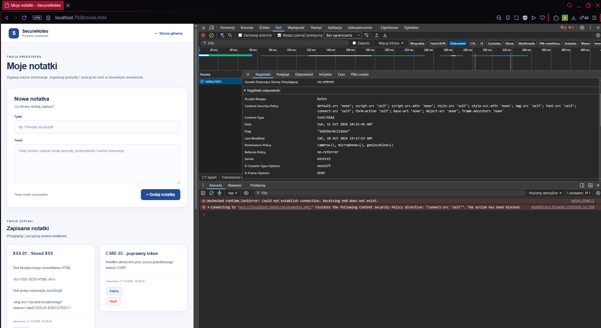

**Data wykonania:** 11.10.2026.

**Uwagi:** Test przeprowadzono na rzeczywistej odpowiedzi HTTP serwera, bez zmiany konfiguracji aplikacji. 
			Sprawdzono obecność i wartość nagłówka; nie wykonywano osobnego testu zachowania przeglądarki dla plików z celowo błędnym typem MIME.


---


### HEAD-03 — Weryfikacja nagłówka X-Frame-Options

**Cel:** sprawdzenie, czy aplikacja SecureNotes wysyła nagłówek `X-Frame-Options: DENY`, 
			ograniczający możliwość osadzania jej stron wewnątrz ramek i stanowiący dodatkową ochronę przed atakami typu clickjacking.

**Warunki początkowe:** uruchomiona aplikacja SecureNotes, aktywny SecurityHeadersMiddleware oraz otwarta przeglądarka Opera GX.

**Przebieg:**
1. Otworzono stronę `https://localhost:7028/notes.html`.
2. Uruchomiono Opera GX DevTools i przełączono się do zakładki Network.
3. Wybrano żądanie dokumentu GET `/notes.html`.
4. Sprawdzono kod odpowiedzi HTTP oraz sekcję Response Headers.
5. Zweryfikowano obecność nagłówka `X-Frame-Options` i jego wartość.

**Oczekiwany wynik:** HTTP 200 OK oraz obecność nagłówka `X-Frame-Options: DENY`.

**Wynik rzeczywisty:** Serwer zwrócił HTTP 200 OK. W nagłówkach odpowiedzi znajdował się `X-Frame-Options` o wartości `DENY`.

**Ocena:** PASS.

**Dowód:** `screenshots/headers/head-03-x-frame-options-deny.png`

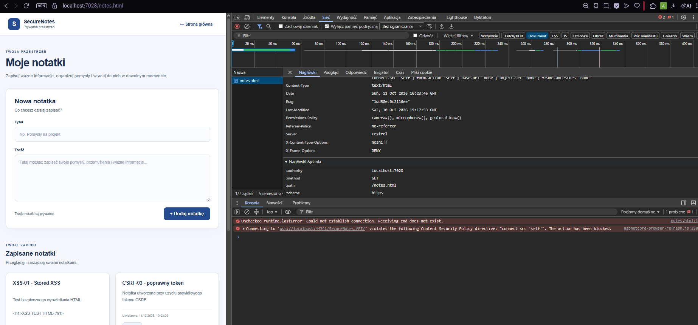

**Data wykonania:** 11.10.2026.

**Uwagi:** Nagłówek X-Frame-Options stanowi dodatkową warstwę ochrony obok potwierdzonej wcześniej dyrektywy CSP `frame-ancestors 'none'`. 
			Test zweryfikował obecność i wartość nagłówka w rzeczywistej odpowiedzi HTTP. Nie przeprowadzano osobnego testu próby osadzenia aplikacji wewnątrz elementu iframe.


---

### COOKIE-01 — Weryfikacja atrybutów ciasteczka uwierzytelniającego

**Cel:** sprawdzenie, czy ciasteczko uwierzytelniające `SecureNotes.Auth` posiada właściwe atrybuty bezpieczeństwa: `HttpOnly`, `Secure` oraz `SameSite=Strict`.

**Warunki początkowe:** uruchomiona aplikacja SecureNotes pod adresem HTTPS, aktywne mechanizmy bezpieczeństwa oraz dostępne konto testowe A.

**Przebieg:**
1. Otworzono aplikację SecureNotes w przeglądarce Opera GX.
2. Wylogowano się, a następnie ponownie zalogowano na konto testowe A.
3. Uruchomiono Opera GX DevTools i otworzono zakładkę Application → Storage → Cookies.
4. Wybrano domenę `https://localhost:7028` i odnaleziono ciasteczko `SecureNotes.Auth`.
5. Sprawdzono ustawienia `HttpOnly`, `Secure` oraz `SameSite`.
6. Przygotowano zrzut ekranu dokumentujący atrybuty ciasteczka, zakrywając jego rzeczywistą wartość.

**Oczekiwany wynik:** ciasteczko `SecureNotes.Auth` ma włączone `HttpOnly` i `Secure`, a jego atrybut `SameSite` ma wartość `Strict`.

**Wynik rzeczywisty:** W DevTools potwierdzono, że ciasteczko `SecureNotes.Auth` posiada aktywne atrybuty `HttpOnly` i `Secure` oraz ustawienie `SameSite=Strict`.

**Ocena:** PASS.

**Dowód:** `screenshots/headers/cookie-01-auth-cookie-flags.png`

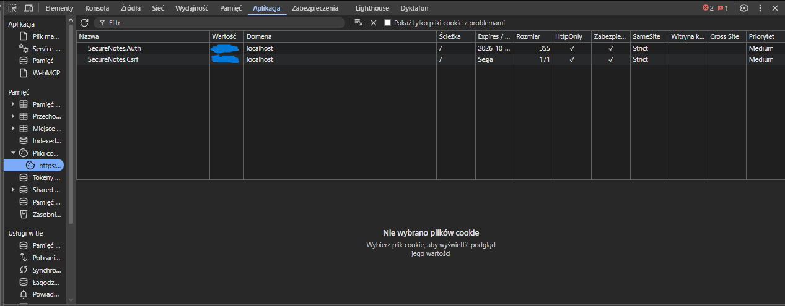

**Data wykonania:** 11.10.2026.

**Uwagi:** Wartość ciasteczka zawierająca token JWT została zakryta na materiale dowodowym. Test potwierdza konfigurację atrybutów ciasteczka w przeglądarce. 
			Nie stanowi osobnego testu wszystkich możliwych scenariuszy kradzieży lub ponownego użycia tokenu sesyjnego.


---

### ZAP-01 — Analiza pasywna OWASP ZAP

**Cel:** przeprowadzenie kontrolowanej analizy pasywnej lokalnej aplikacji SecureNotes oraz sklasyfikowanie wykrytych alertów pod kątem ich rzeczywistego znaczenia dla badanego projektu.

**Środowisko:** OWASP ZAP 2.17.0, lokalna aplikacja `https://localhost:7028`, profil Development, tryb bezpieczny (Safe Mode).

**Zakres:** ruch aplikacji SecureNotes zebrany podczas ręcznego przeglądania stron za pośrednictwem przeglądarki uruchomionej przez OWASP ZAP.

**Status:** analiza w toku.

#### Ustalenie 1 — X-Content-Type-Options Header Missing

ZAP wykrył trzy wystąpienia alertu o niskim poziomie ryzyka:

1. `edge-consumer-static.azureedge.net` — zewnętrzny zasób przeglądarki Edge, poza zakresem audytu SecureNotes.
2. `localhost:7028/_framework/aspnetcore-browser-refresh.js` — pomocniczy skrypt Browser Refresh środowiska ASP.NET Core Development.
3. `xpaywalletcdn-prod.azureedge.net` — zewnętrzny zasób przeglądarki Edge, poza zakresem audytu SecureNotes.

Wystąpienie dotyczące lokalnego skryptu wskazuje na brak nagłówka `X-Content-Type-Options: nosniff` w odpowiedzi dla zasobu Browser Refresh. Nie dotyczy ono dokumentu `/notes.html`, dla którego obecność tego nagłówka została wcześniej potwierdzona w HEAD-02.

Ustalenie zaklasyfikowano jako dotyczące pomocniczego zasobu lokalnego środowiska programistycznego. Nie zmieniano konfiguracji aplikacji ani oryginalnych alertów ZAP podczas przeprowadzania analizy.

**Dowody:**
- `screenshots/zap/zap-01-nosniff-alert-analysis.png`
- `screenshots/zap/zap-01-browser-refresh-alert.png`

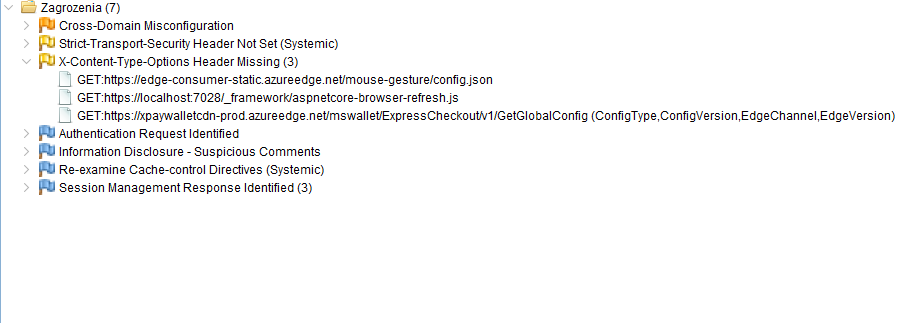

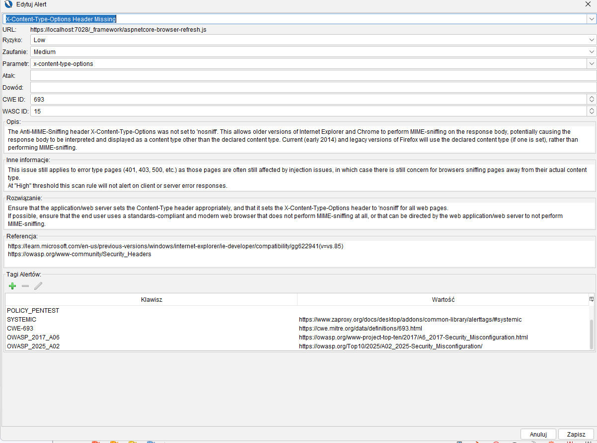

**Ocena końcowa ZAP-01:** do ustalenia po przeanalizowaniu pozostałych alertów.

---

#### Ustalenie 2 — Strict-Transport-Security Header Not Set (Systemic)

Podczas analizy pasywnej OWASP ZAP wykrył brak nagłówka `Strict-Transport-Security` w odpowiedziach HTTPS lokalnej aplikacji SecureNotes.

**Poziom ryzyka według ZAP:** Low (niskie).

**Poziom pewności:** High (wysoki).

**Przykładowe adresy objęte alertem:**
- `https://localhost:7028/`
- `https://localhost:7028/api/auth/me`
- `https://localhost:7028/css/style.css`
- `https://localhost:7028/js/api.js`
- `https://localhost:7028/js/home.js`

ZAP zgłosił także wystąpienie dotyczące domeny `edge-consumer-static.azureedge.net`, która stanowi zewnętrzny zasób przeglądarki i nie należy do zakresu badanego projektu.

**Analiza:** Brak nagłówka HSTS jest rzeczywistym ustaleniem konfiguracyjnym dotyczącym lokalnego środowiska SecureNotes. Aplikacja była testowana pod adresem HTTPS, jednak samo korzystanie z HTTPS nie zastępuje polityki HSTS.

**Ocena kontekstowa:** ustalenie dotyczy uruchomienia aplikacji w środowisku Development. Nie zweryfikowano konfiguracji wdrożenia produkcyjnego. Przed ewentualnym wdrożeniem należy uwzględnić i zweryfikować konfigurację HSTS właściwą dla produkcyjnej domeny i infrastruktury HTTPS.

Nie modyfikowano konfiguracji aplikacji wyłącznie w celu wyeliminowania alertu podczas audytu.

**Dowody:**
- `screenshots/zap/zap-01-hsts-affected-urls.png`
- `screenshots/zap/zap-01-hsts-localhost-detail.png`

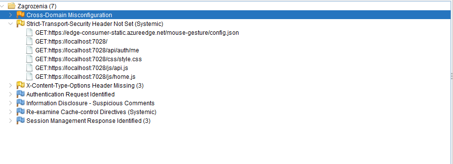

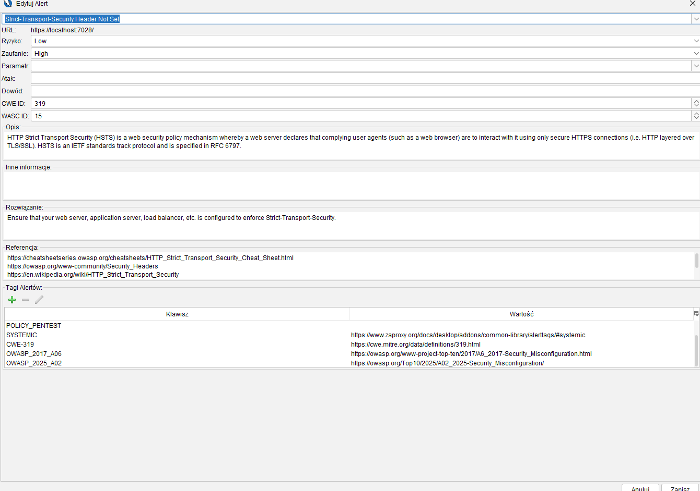

---

#### Ustalenie 3 — Cross-Domain Misconfiguration

OWASP ZAP wykrył alert `Cross-Domain Misconfiguration` o średnim poziomie ryzyka i średnim poziomie pewności.

**Adres objęty alertem:** `https://edge-consumer-static.azureedge.net/mouse-gesture/config.json`.

**Dowód wskazany przez ZAP:** `Access-Control-Allow-Origin: *`.

**Analiza:** zgłoszenie dotyczy zewnętrznego zasobu przeglądarki Microsoft Edge, który pojawił się w historii proxy podczas ręcznego przeglądania SecureNotes. Nie dotyczy ono żadnego z endpointów aplikacji `https://localhost:7028`.

**Klasyfikacja:** poza zakresem audytu SecureNotes (*Out of Scope*).

Alert nie stanowi dowodu na nieprawidłową konfigurację CORS badanego projektu. Nie zmieniano konfiguracji SecureNotes ani nie usuwano oryginalnego alertu ZAP.

**Dowód:** `screenshots/zap/zap-01-cors-external-domain.png`

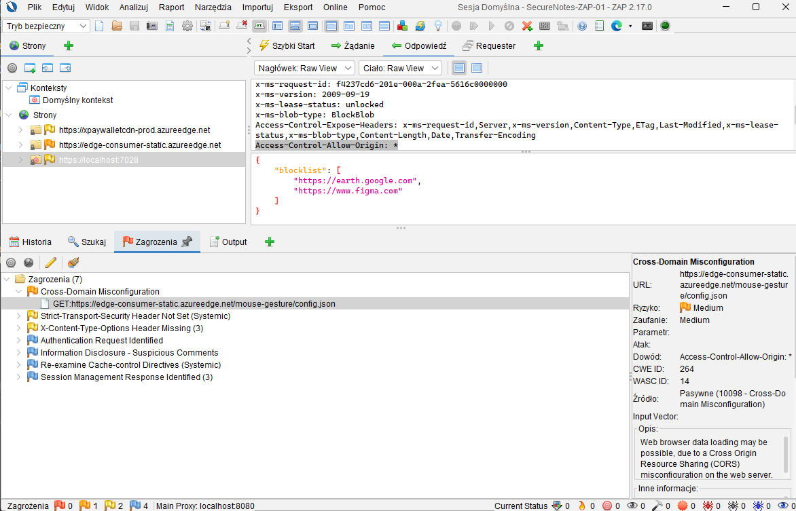

---

#### Ustalenie 4 — Information Disclosure: Suspicious Comments

OWASP ZAP wykrył alert informacyjny `Information Disclosure - Suspicious Comments` w odpowiedzi:

`https://localhost:7028/_framework/aspnetcore-browser-refresh.js`

**Poziom ryzyka:** Informational.

**Poziom pewności:** Medium.

**Wykryty fragment:** komentarz dotyczący obsługi poprzedniej aktualizacji przez mechanizm Browser Refresh.

**Analiza:** zgłoszenie dotyczy pomocniczego skryptu ASP.NET Core wykorzystywanego w środowisku Development, a nie własnego kodu biznesowego SecureNotes. W przedstawionym fragmencie nie zidentyfikowano haseł, tokenów, kluczy API ani danych użytkowników.

**Klasyfikacja:** alert informacyjny związany z lokalnym środowiskiem programistycznym; brak wykazanego ujawnienia danych wrażliwych.

Nie zmieniano kodu aplikacji ani oryginalnego alertu ZAP.

**Dowód:** `screenshots/zap/zap-01-suspicious-comments-detail.png`

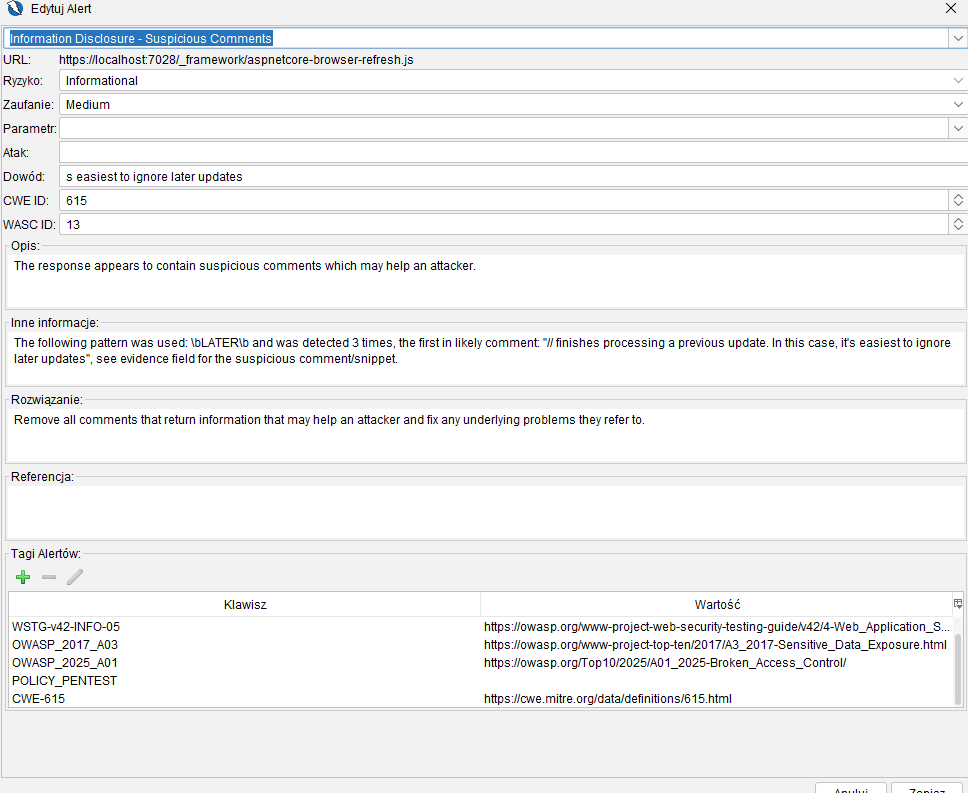

---

#### Ustalenie 5 — Re-examine Cache-control Directives (Systemic)

OWASP ZAP wygenerował informacyjny alert dotyczący konieczności przeglądu zasad buforowania odpowiedzi HTTP.

**Poziom ryzyka:** Informational.

**Poziom pewności:** Low.

Alert obejmował sześć odpowiedzi, w tym cztery adresy lokalnej aplikacji SecureNotes:

- `https://localhost:7028/`
- `https://localhost:7028/api/auth/csrf-token`
- `https://localhost:7028/login.html`
- `https://localhost:7028/register.html`

Pozostałe dwa wystąpienia dotyczyły zewnętrznych domen wykorzystywanych przez przeglądarkę Edge i zostały wyłączone z interpretacji wyników SecureNotes.

**Analiza:** dla endpointu GET `/api/auth/csrf-token` ZAP wskazał nagłówek `Cache-Control: no-cache, no-store`, który ogranicza przechowywanie odpowiedzi zawierającej token CSRF. Dla strony głównej oraz formularzy logowania i rejestracji pole Evidence nie zawierało wartości pozwalającej jednoznacznie ocenić politykę buforowania.

Sam alert informacyjny nie potwierdza przechowywania prywatnych notatek w pamięci podręcznej. Zasadne jest jednak osobne zweryfikowanie nagłówków odpowiedzi zawierających dane użytkownika.

**Klasyfikacja:** ustalenie informacyjne wymagające przeglądu polityki Cache-Control dla wybranych odpowiedzi aplikacji. Dla endpointu wydającego token CSRF potwierdzono obecność `no-cache, no-store`.

**Dowody:**
- `screenshots/zap/zap-01-cache-affected-urls.png`
- `screenshots/zap/zap-01-cache-csrf-token.png`
- `screenshots/zap/zap-01-cache-homepage.png`

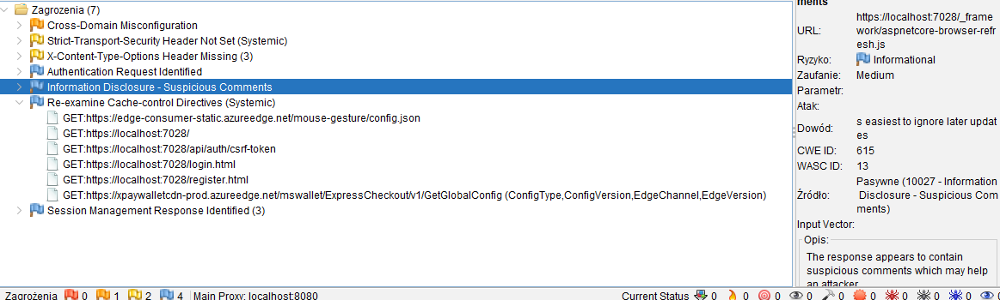

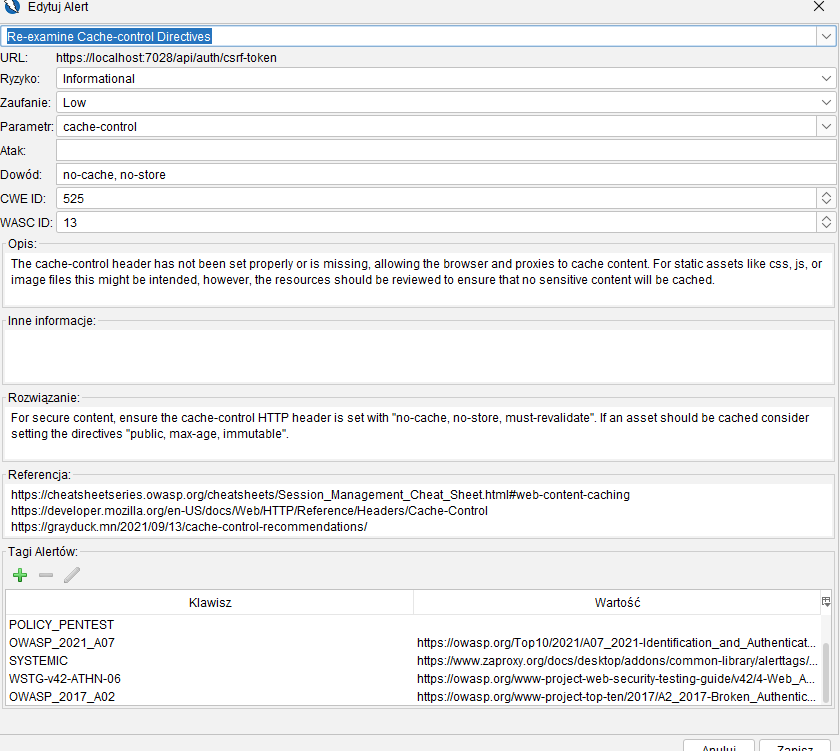

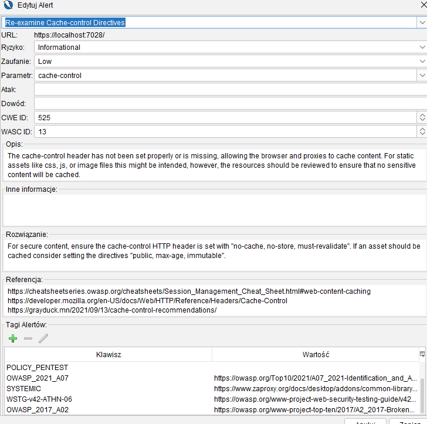

---

**Dodatkowa weryfikacja prywatnych danych:**

W ramach analizy sprawdzono również odpowiedź GET `/api/notes` dla poprawnie zalogowanego użytkownika.

Serwer zwrócił HTTP 200 OK z prywatnymi notatkami użytkownika. W nagłówkach odpowiedzi nie stwierdzono obecności `Cache-Control`.

**Ocena:** ustalenie konfiguracyjne wymagające poprawy. Dla odpowiedzi API zawierających prywatne dane zaleca się jawne ustawienie `Cache-Control: no-store`, aby ograniczyć ich przechowywanie przez pamięci podręczne.

Brak nagłówka nie stanowi sam w sobie dowodu faktycznego ujawnienia danych.

**Dodatkowy dowód:** `screenshots/zap/zap-01-private-notes-cache-header.png`

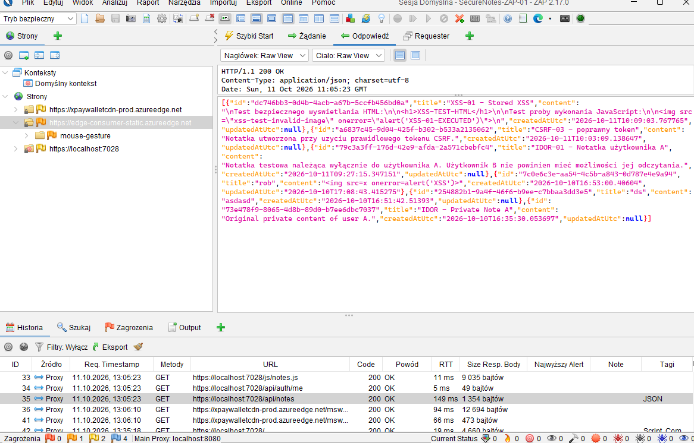

---

#### Ustalenie 6 — Authentication Request Identified

OWASP ZAP rozpoznał żądanie uwierzytelniające aplikacji SecureNotes.

**Endpoint:** POST `/api/auth/login`.

**Poziom ryzyka:** Informational.

**Poziom pewności:** High.

**Rozpoznane parametry:**
- identyfikator użytkownika: `email`;
- parametr hasła: `password`.

**Analiza:** zgłoszenie informuje o rozpoznaniu mechanizmu logowania przez skaner. Nie stanowi samodzielnie dowodu występowania podatności ani ujawnienia danych uwierzytelniających.

**Klasyfikacja:** informacyjne rozpoznanie endpointu logowania; brak wykazanej podatności.

Przed zapisaniem materiału dowodowego zakryto wartość identyfikatora użytkownika. Nie umieszczono w dokumentacji hasła ani wartości tokenów sesyjnych.

**Dowód:** `screenshots/zap/zap-01-authentication-request-identified.png`

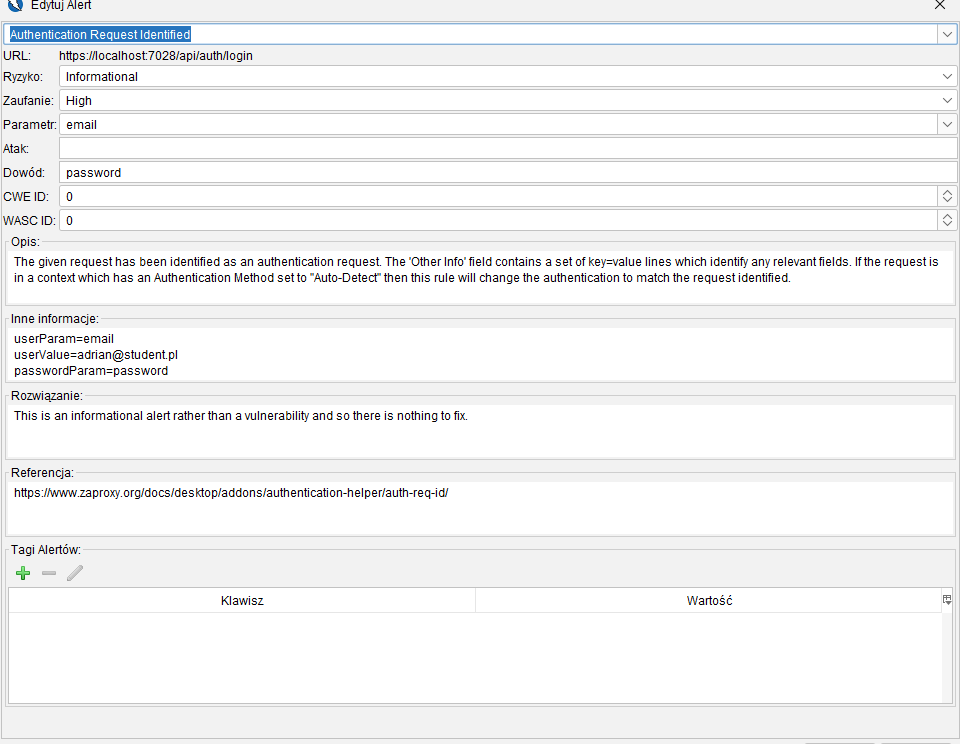

---

#### Ustalenie 7 — Session Management Response Identified

OWASP ZAP zidentyfikował trzy odpowiedzi związane z mechanizmem zarządzania sesją SecureNotes.

**Poziom ryzyka:** Informational.

**Rozpoznane elementy:**
- GET `/api/auth/csrf-token` — token w odpowiedzi JSON oraz ciasteczko `SecureNotes.Csrf`;
- POST `/api/auth/login` — ciasteczko uwierzytelniające `SecureNotes.Auth` (dwa wystąpienia).

**Analiza:** skaner poprawnie rozpoznał odpowiedzi zawierające mechanizmy sesyjne. Samo wystąpienie tego alertu nie oznacza ujawnienia tokenów ani nieprawidłowego zarządzania sesją.

**Klasyfikacja:** informacyjne rozpoznanie mechanizmu uwierzytelniania i ochrony CSRF; brak wykazanej podatności.

W materiałach dowodowych przedstawiono wyłącznie nazwy rozpoznanych mechanizmów. Nie publikowano wartości ciasteczek ani tokenów.

**Dowody:**
- `screenshots/zap/zap-01-session-management-list.png`
- `screenshots/zap/zap-01-session-management-auth.png`

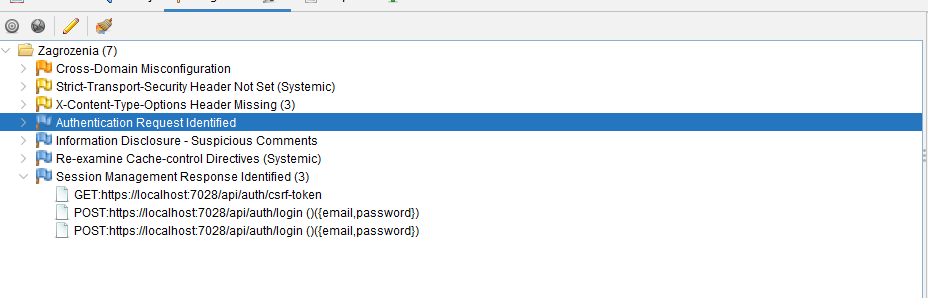

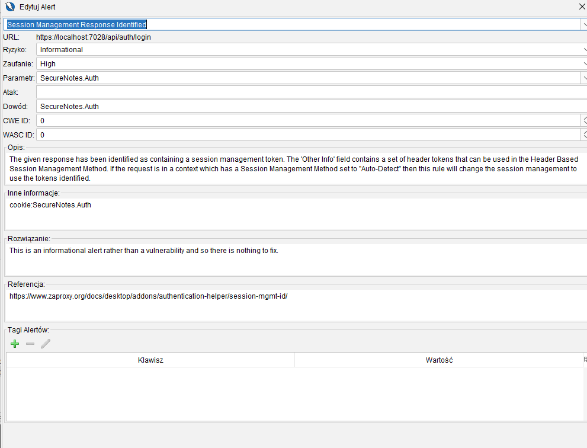

---

#### Wynik końcowy ZAP-01

**Przebieg końcowy:** przeprowadzono ręczną eksplorację lokalnej aplikacji SecureNotes z wykorzystaniem przeglądarki uruchomionej przez OWASP ZAP 2.17.0. 
						Narzędzie pracowało w trybie Safe Mode. Nie wykonywano Active Scan, Spider ani fuzzingu.

Po zakończeniu przeglądania aplikacji potwierdzono, że kolejka analizy pasywnej wynosiła 0. Wykryto siedem kategorii alertów. 
Wszystkie zostały poddane analizie uwzględniającej adresy URL, poziom ryzyka, przedstawione dowody oraz kontekst środowiska Development.

**Klasyfikacja końcowa:**

|			Kategoria alertu					|											Wynik analizy																	|
|-----------------------------------------------|---------------------------------------------------------------------------------------------------------------------------|
| Cross-Domain Misconfiguration					| Zewnętrzny zasób Microsoft Edge — poza zakresem SecureNotes																|
| Strict-Transport-Security Header Not Set		| Potwierdzony brak HSTS w lokalnym środowisku Development																	|
| X-Content-Type-Options Header Missing			| Jedno wystąpienie dotyczące lokalnego skryptu Browser Refresh i dwa dotyczące zasobów zewnętrznych						|
| Authentication Request Identified				| Informacyjne rozpoznanie endpointu logowania																				|
| Information Disclosure – Suspicious Comments	| Komentarz pomocniczego skryptu Browser Refresh; brak wykazanego ujawnienia danych wrażliwych								|
| Re-examine Cache-control Directives			| Potwierdzony brak Cache-Control w badanej odpowiedzi GET `/api/notes`; endpoint tokenu CSRF posiada `no-cache, no-store`	|
| Session Management Response Identified		| Informacyjne rozpoznanie mechanizmów sesyjnych i CSRF																		|

**Zalecenia po analizie:**

1. Przed wdrożeniem produkcyjnym skonfigurować i zweryfikować właściwą politykę HTTP Strict Transport Security (HSTS).
2. Dodać i zweryfikować `Cache-Control: no-store` dla odpowiedzi API zawierających prywatne dane użytkownika, w szczególności GET `/api/notes`.
3. Przygotować osobną weryfikację konfiguracji produkcyjnej bez pomocniczych elementów środowiska Development.

**Ocena ZAP-01:** PASS — zaplanowana analiza pasywna została wykonana, a wszystkie wykryte kategorie alertów przeanalizowano i udokumentowano.

Ocena PASS odnosi się do poprawnego wykonania scenariusza audytowego. Nie oznacza braku ustaleń bezpieczeństwa ani odporności aplikacji na wszystkie możliwe ataki.

**Dowód końcowy:** `screenshots/zap/zap-01-final-alert-summary.png`


**Data wykonania:** 11.10.2026.

---

## 4. Znane ograniczenia

Swagger UI wyświetla obecnie pustą stronę przy aktywnej restrykcyjnej polityce CSP. `SecurityHeadersMiddleware` pozostaje włączony. 
Ograniczenie zostało opisane w głównym README projektu.