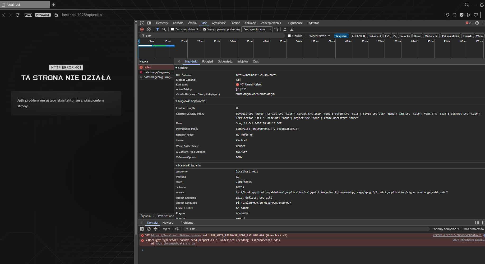
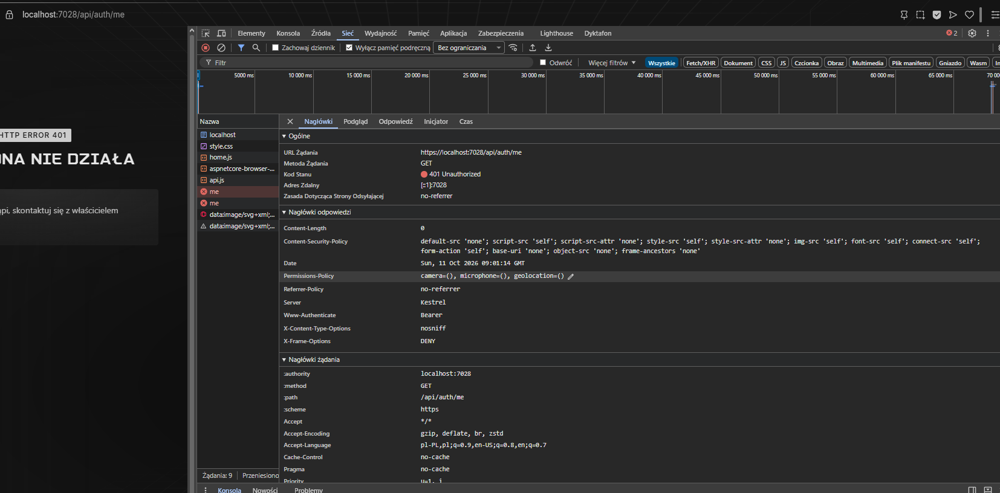
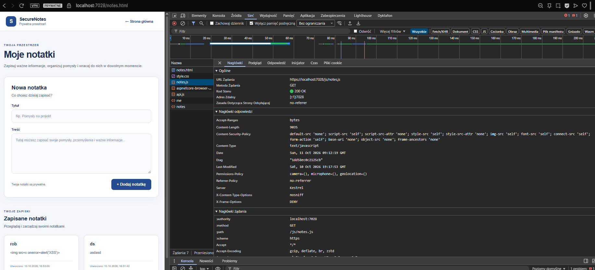
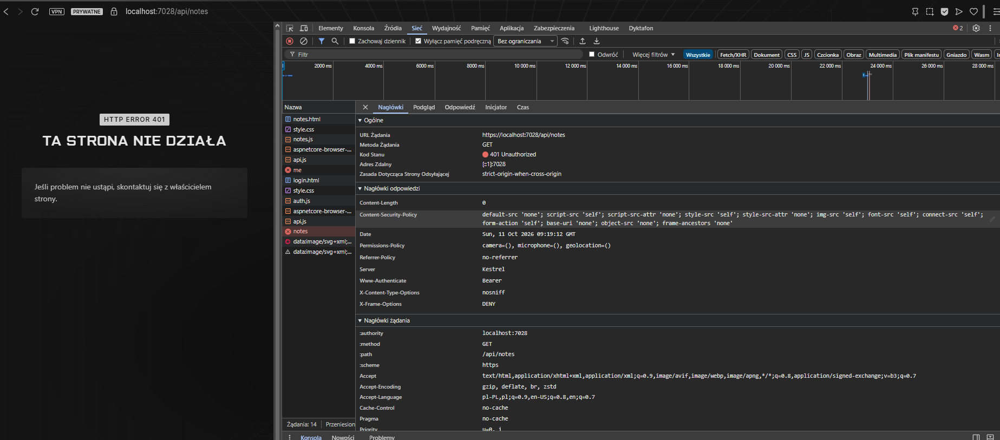

# SecureNotes — wyniki końcowych testów bezpieczeństwa

## Informacje o audycie

- Projekt: SecureNotes
- Branch: `test/security-audit`
- Adres aplikacji: `https://localhost:7028/`
- Środowisko: lokalne, ASP.NET Core .NET 8, MariaDB
- Ostatni potwierdzony wynik testów automatycznych przed audytem: 82/82
- Status audytu: w trakcie realizacji

Dokument zawiera wyniki rzeczywiście wykonanych testów. Scenariusze oczekujące na wykonanie mają status NOT RUN.

---

## 1. Podsumowanie wyników

| ID | Obszar | Oczekiwany wynik | Rzeczywisty wynik | Ocena |
|---|---|---|---|---|
| AUTH-01 | Dostęp do notatek bez sesji | HTTP 401 | HTTP 401 Unauthorized | PASS |
| AUTH-02 | Dostęp do /api/auth/me bez sesji | HTTP 401 | HTTP 401 Unauthorized | PASS |
| AUTH-03 | Dostęp do notatek po logowaniu | HTTP 200 | HTTP 200 OK | PASS |
| AUTH-04 | Dostęp do notatek po wylogowaniu | HTTP 401 | HTTP 401 Unauthorized | PASS |
| IDOR-01 | Odczyt cudzej notatki | HTTP 404 | Do sprawdzenia | NOT RUN |
| IDOR-02 | Edycja cudzej notatki | HTTP 404, brak zmiany danych | Do sprawdzenia | NOT RUN |
| IDOR-03 | Usunięcie cudzej notatki | HTTP 404, notatka nadal istnieje | Do sprawdzenia | NOT RUN |
| CSRF-01 | Brak tokenu CSRF | HTTP 400 | Do sprawdzenia | NOT RUN |
| CSRF-02 | Nieprawidłowy token CSRF | HTTP 400 | Do sprawdzenia | NOT RUN |
| CSRF-03 | Prawidłowy token CSRF | HTTP 201 | Do sprawdzenia | NOT RUN |
| XSS-01 | Wyświetlanie testowej treści HTML | Brak wykonania skryptu | Do sprawdzenia | NOT RUN |
| HEAD-01 | Nagłówek CSP | Obecny | Do sprawdzenia | NOT RUN |
| HEAD-02 | X-Content-Type-Options | nosniff | Do sprawdzenia | NOT RUN |
| HEAD-03 | X-Frame-Options | DENY | Do sprawdzenia | NOT RUN |
| COOKIE-01 | Właściwości ciasteczka sesyjnego | HttpOnly, Secure, SameSite=Strict | Do sprawdzenia | NOT RUN |
| ZAP-01 | OWASP ZAP | Analiza i udokumentowanie ustaleń | Do sprawdzenia | NOT RUN |

---

## 2. Szczegółowe wyniki

### AUTH-01 — Dostęp do notatek bez uwierzytelnienia

**Cel:** sprawdzenie, czy użytkownik bez aktywnej sesji może pobrać prywatne notatki przez API.

**Warunki początkowe:** prywatne okno Opera GX, brak aktywnej sesji użytkownika.

**Przebieg:**
1. Uruchomiono aplikację SecureNotes.
2. Otworzono prywatne okno przeglądarki.
3. Wykonano żądanie GET `/api/notes`.
4. Sprawdzono odpowiedź w Opera GX DevTools, w zakładce Network → Headers.

**Oczekiwany wynik:** HTTP 401 Unauthorized. Brak dostępu do prywatnych notatek.

**Wynik rzeczywisty:** Serwer zwrócił HTTP 401 Unauthorized. Odpowiedź miała `Content-Length: 0`, a prywatne notatki nie zostały udostępnione.

**Ocena:** PASS.

**Dowód:** `screenshots/auth/auth-01-unauthorized-notes.png`

**Data wykonania:** 11.10.2026.

**Uwagi:** Dodatkowo zaobserwowano obecność nagłówków bezpieczeństwa, w tym Content-Security-Policy, X-Content-Type-Options oraz X-Frame-Options. 
			Ich szczegółowa weryfikacja zostanie przeprowadzona w osobnej grupie testów HEAD.

---

### AUTH-02 — Weryfikacja sesji bez uwierzytelnienia

**Cel:** sprawdzenie, czy endpoint `/api/auth/me` odmawia udostępnienia informacji o aktualnym użytkowniku w przypadku braku aktywnej sesji.

**Warunki początkowe:** prywatne okno Opera GX, użytkownik niezalogowany.

**Przebieg:**
1. Uruchomiono aplikację SecureNotes.
2. W prywatnym oknie przeglądarki wykonano żądanie GET `/api/auth/me`.
3. W narzędziach deweloperskich, w zakładce Network → Headers, sprawdzono status odpowiedzi HTTP.

**Oczekiwany wynik:** HTTP 401 Unauthorized.

**Wynik rzeczywisty:** Serwer zwrócił HTTP 401 Unauthorized i odmówił dostępu do informacji o aktualnym użytkowniku.

**Ocena:** PASS.

**Dowód:** `screenshots/auth/auth-02-unauthorized-me.png`

**Data wykonania:** 11.10.2026.

**Uwagi:** Test przeprowadzono bez aktywnej sesji, w prywatnym oknie przeglądarki. Endpoint poprawnie wymaga uwierzytelnienia.

---

### AUTH-03 — Dostęp do notatek po zalogowaniu

**Cel:** sprawdzenie, czy poprawnie uwierzytelniony użytkownik może pobrać listę swoich prywatnych notatek.

**Warunki początkowe:** aktywna sesja testowego użytkownika w prywatnym oknie Opera GX.

**Przebieg:**
1. Uruchomiono lokalną aplikację SecureNotes.
2. Zalogowano się przez formularz logowania na konto testowe.
3. W tym samym oknie przeglądarki wykonano żądanie GET `/api/notes`.
4. Sprawdzono odpowiedź w Opera GX DevTools, w zakładce Network → Headers.

**Oczekiwany wynik:** HTTP 200 OK oraz odpowiedź zawierająca listę notatek użytkownika lub pustą tablicę JSON.

**Wynik rzeczywisty:** Serwer zwrócił HTTP 200 OK. Uwierzytelniony użytkownik uzyskał dostęp do endpointu swoich notatek.

**Ocena:** PASS.

**Dowód:** `screenshots/auth/auth-03-authorized-notes.png`

**Data wykonania:** 11.10.2026.

**Uwagi:** Test potwierdza dostęp do chronionego endpointu z aktywną sesją JWT. Kontrola dostępu do notatek innych użytkowników będzie przedmiotem osobnych testów IDOR.

---

### AUTH-04 — Dostęp do notatek po wylogowaniu

**Cel:** sprawdzenie, czy użytkownik po wylogowaniu przez interfejs SecureNotes traci dostęp do chronionego endpointu notatek.

**Warunki początkowe:** użytkownik wcześniej poprawnie zalogowany; test AUTH-03 potwierdził dostęp do GET `/api/notes` (HTTP 200).

**Przebieg:**
1. Pozostawiono aktywne prywatne okno przeglądarki po wykonaniu AUTH-03.
2. Wykonano wylogowanie za pomocą interfejsu SecureNotes.
3. Bez zamykania okna i bez ręcznego usuwania ciasteczek ponownie wykonano GET `/api/notes`.
4. Sprawdzono odpowiedź w Opera GX DevTools, w zakładce Network → Headers.

**Oczekiwany wynik:** HTTP 401 Unauthorized. Po wylogowaniu przeglądarka nie powinna mieć dostępu do prywatnych notatek.

**Wynik rzeczywisty:** Serwer zwrócił HTTP 401 Unauthorized. Po wylogowaniu dostęp do chronionego endpointu został zablokowany w badanej sesji przeglądarki.

**Ocena:** PASS.

**Dowód:** `screenshots/auth/auth-04-after-logout.png`

**Data wykonania:** 11.10.2026.

**Uwagi:** Test wykonano w tym samym oknie przeglądarki co AUTH-03. Nie usuwano ręcznie ciasteczek i nie zamykano sesji przeglądarki. 
			Test potwierdza skuteczność wylogowania w standardowym przepływie aplikacji; nie stanowi osobnego testu unieważniania skopiowanego wcześniej tokenu JWT.

---

## 3. Pozostałe grupy testów

Szczegółowe opisy i dowody testów IDOR, CSRF, XSS, nagłówków bezpieczeństwa, ciasteczek oraz OWASP ZAP zostaną dodane w kolejnych etapach audytu.

## 4. Znane ograniczenia

Swagger UI wyświetla obecnie pustą stronę przy aktywnej restrykcyjnej polityce CSP. `SecurityHeadersMiddleware` pozostaje włączony. Ograniczenie zostało opisane w głównym README projektu.